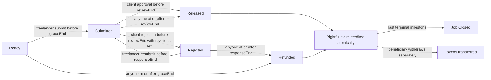

# Phase 2 implemented-state checklist

The following matches the implemented Phase 2 source and the passing boundary/transition tests; see PHASE2_REPORT.md for measured gates and limits. See STATE_MACHINE.md for full P0/Phase 3 target design.

| From | Action | Caller | Boundary | To / rightful credit |
| --- | --- | --- | --- | --- |
| Ready | submitMilestone | Freelancer | now < graceEnd | Submitted; new reviewEnd |
| Ready | refundAfterMissedDeadline | Anyone | now >= graceEnd | Refunded; client |
| Submitted | approveMilestone | Client | now < reviewEnd | Released; freelancer |
| Submitted | rejectMilestone | Client | now < reviewEnd and this milestone's count < revisionLimit | Rejected; responseEnd |
| Submitted | releaseAfterSilence | Anyone | now >= reviewEnd | Released; freelancer |
| Rejected | resubmitMilestone | Freelancer | now < responseEnd | Submitted; next immutable version and fresh reviewEnd |
| Rejected | refundAfterRejectionWindow | Anyone | now >= responseEnd | Refunded; client |
| Released / Refunded | Any transition or repeat credit | Anyone | Always closed | Revert; claim remains independent |

Each milestone is independent. At deadline-1/deadline/deadline+1 a first submission remains valid while graceEnd has not been reached; missing delivery refunds begin only at graceEnd. Every action window is half-open, and public timeout begins at its exact end. ResponseWindow equals the configured fundingWindow under A-23, while reviewWindow is agreed per job. Revision limits 0, 1 and 5, silence after exhaustion and immutable history have named passing tests. All seven mutators are guarded; settlement performs no external token call and no owner can redirect its credit. F-23 amendments and all dispute actions are not implemented.
