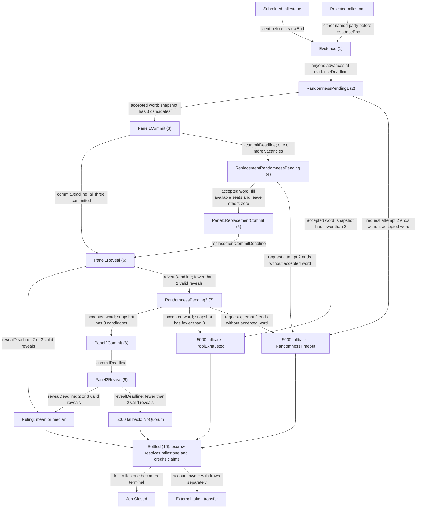

# Phase 3 arbitration state model

Source-verified model for A-28 through A-35 against `contracts/src/FairworkEscrow.sol`, `contracts/src/FairworkArbitration.sol`, `contracts/src/interfaces/IRandomness.sol`, `contracts/src/mocks/MockRandomness.sol`, and `docs/PHASE3_API.md`. The verified builder build and full 109-test suite passed; root-owned coverage and static-analysis gates remain separate. This is the local-only Tier A scope; stakes, slashing, and salaries remain disabled.

The phase numbers and transitions below match `PHASE3_API.md`. Opening and matching deposits are escrow operations; the engine owns arbitration phases and never owns the token or claim ledger.

All five new windows—evidence, commit, replacement commit, reveal, and randomness timeout—equal the immutable `fundingWindow`; the deposit rate is fixed at 200 basis points, with a one-raw-unit minimum. Actor windows are open only while `now < end`; permissionless advancement becomes due at `now >= end`. Evidence closure always starts a Panel 1 request, and insufficient candidate count is decided only when accepted entropy is consumed.

Each draw snapshots up to 128 eligible candidates before its first provider request; retries retain that same snapshot and use fresh request IDs. The engine enters a pending phase even for a short or empty snapshot, and caught provider failure leaves the timed request pending. A callback from the immutable adapter only stores a word if its request is current, still pending, not already fulfilled, and received before `requestEnd`; a stored word may be consumed by a later `advanceDispute` even after that end. With no stored word, the third request attempt's deadline applies `RandomnessTimeout` fallback.

Each draw excludes both parties and every address already in Panel 1 history; that history starts empty and retains all initial and replacement assignees (at most six). The fresh Panel 2 draw therefore excludes all Panel 1 members, including replacements. One aggregate replacement request fills only available vacancies; sparse or empty replacement results retain zero seats and still receive the shared replacement commit window. Panel 2 has no replacement or third-panel path. Two valid reveals are quorum; three are combined by median, while two use the floored mean.

The opener posts `D = max(1, floor(amount * 200 / 10000))`; only the counterparty may match once before `evidenceDeadline`. Evidence is limited to five nonzero hash commitments per party, with opaque references and no clock restart. A disputed milestone cannot use Phase 2 review or response settlement, while other milestones continue independently.

On a normal ruling, the engine records the ruling and the escrow atomically partitions the locked principal, refunds posted deposits net of any forfeiture, and caps an absent party's deposit deduction at that party's principal payout. At a normal 5000-bps ruling each side's forfeiture is `floor(D/2)`; every fallback is also 5000 bps but refunds every posted deposit and forfeits nothing. The escrow removes the corresponding principal and posted-deposit liabilities and adds the credits to `claimable` and `totalClaimable` in the same transaction, without calling the token; withdrawals transfer tokens separately. `Resolved` is terminal, and the job closes when every milestone is terminal.

Arbiter, evidence, randomness, panel, phase, vote, ruling, and fallback events originate from the engine. Deposit, open, settlement-credit, `MilestoneResolved`, compatible claim-credit, and job-closure events originate from the escrow; the exact minimum signatures are in `PHASE3_API.md`. The demo adapter's output is deterministic and predictable, so it is not verifiable randomness and is not suitable for public funds.

## Bounded exit scope

A longest successful path can require 15 due public advances: evidence closes (1); each of three draws can require two retries and one entropy-consumption step (9); first commit, replacement commit, first reveal, second commit and second reveal add five. A third failed request ends earlier in fallback. This counts valid due steps, not arbitrary premature or terminal calls; somebody must submit each transaction, so disappearance of all transaction senders cannot give a wall-clock guarantee.

The compact Phase 3 invariant handler has a narrower 12-step bound for its sampled full traces: immediate entropy on all draws, or initial-request timeout fallback. It begins with a live dispute, checks liabilities after each step, proves one terminalization in `afterInvariant`, and makes later campaign calls no-ops. Final evidence should report these as finite sampled traces, not 8,192 independent exits or an exhaustive proof of call-order interleavings. Other fixed tests exercise retries at each draw, snapshot edits, sparse replacements, exact timing and role failures, and vote-phase error selectors.
