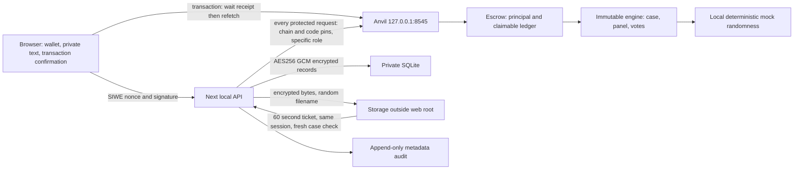
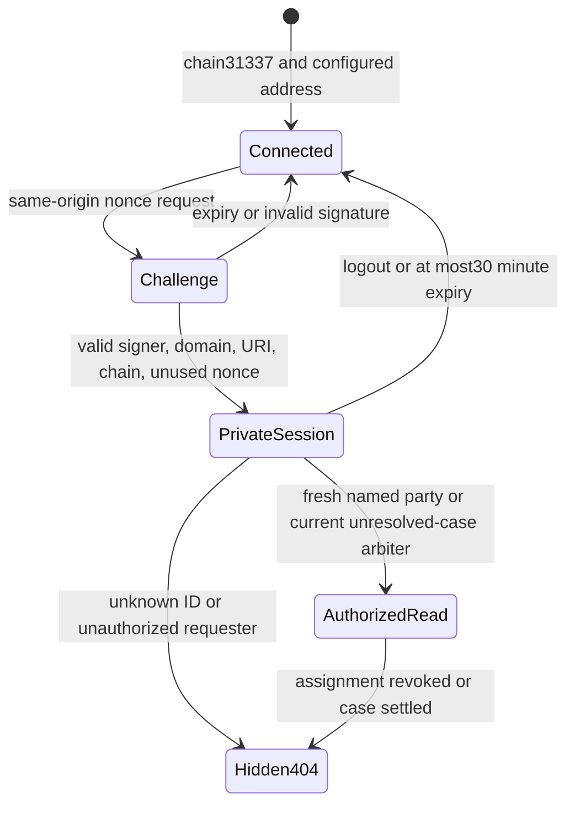

# Local application authority and privacy

Reopened Phase 4: creating a new job clears the old job's private cache before publishing its chain snapshot. Settled disputes remain readable as public history; displayed credits come from matching resolution/credit events. Uploads are shared with both named agreement parties, including drafts; arbiter access still requires current case assignment and chain binding. The local treasury selector is for recipient-only withdrawal checks. The isolated artifact-test packaging target is nondeployable; public builds remain blocked pending approved inputs.

The arbiter roster is read from the pinned escrow deployment by reading `owner()`, `arbiterCount()` and each `arbiterAt()` value at one block. The UI shows that chain-derived owner and roster to all roles; only the connected on-chain owner gets enabled add/remove controls. Before a write, the existing transaction flow rechecks the connected account, chain and current owner/member state, then refreshes the registry only after a confirmed receipt. Registry changes affect future panel selection; already assigned panels remain immutable snapshots. The local proof added and removed one synthetic wallet (6→7→6) at blocks 528–529 and confirmed all 32 recorded panels were unchanged (`phase4-reopen-registry-browser.txt`, `phase4-reopen-registry-chain-proof.json`). The registry mobile view was visually reviewed at a 375px viewport with a 360px document width and no captured console warnings/errors (`phase4-reopen-registry-mobile.png`). The current reopened web suite passes 105/105 (`phase4-reopen-registry-standalone-tests.txt`). Demo wallets are synthetic: real arbiters require off-chain identity vetting, and the UI collects no identity details. Populated 128-member UI/chain stress remains untested. Reopened web and chain services were stopped, with no listeners remaining on ports 3000, 8545 or 8080 (`phase4-reopen-registry-services-stopped.txt`).

The blockchain controls parties, deadlines, assignment, settlement and withdrawal. The web server stores encrypted descriptions and files; it cannot credit money, override a contract deadline or authorize a stranger by accepting an address from a request body.

The contract state diagrams remain [PHASE3_STATE_MACHINE.md](PHASE3_STATE_MACHINE.md) and [PHASE2_STATE_MACHINE.md](PHASE2_STATE_MACHINE.md); Phase4 adds no contract states. Evidence text and files use separate commitments and references. A file becomes readable by an arbiter only when its raw-byte hash and reference match that arbiter's specific unresolved case; a successful upload alone does not grant that permission.

Amounts use integer raw units. Principal locked in escrow, a wallet's withdrawable claim, and tokens already transferred out are separate facts; a successful settlement is not a withdrawal. The withdrawn figure is wallet-and-token history, not money attributed exclusively to the currently displayed job.

A confirmed transaction preserves its receipt-dependent private payload before the next chain read. A failed refresh keeps the receipt visible, marks the chain view stale, and blocks further transactions until a fresh read succeeds. Uploaded files remain drafts until their exact hash/reference is verified on chain. Evidence retries reconcile the party, dispute, hash and reference against fresh events, so an already committed file does not consume another evidence slot. Wallet changes clear private data and refresh wallet-specific balances under the newly selected account.

Private responses may update caches only when their captured wallet, session, job and request generation still match after all requests settle. New reads and explicit clearing invalidate older work synchronously; a stale invocation is ignored. A definitive reverted receipt makes an evidence draft retryable; a timeout or unrecognized receipt status keeps it blocked against duplicate submission.

The public manifest contains addresses, roles, token decimals and runtime code hashes. It contains no private keys, AES key or session secret. Private jobs have no enumeration route. Plain text is rendered through React text nodes; uploaded content is served only as an authenticated attachment with no-store and nosniff.

AES encryption protects stored bytes, not the server operator or a browser that already received authorized plaintext. Authorized recipients can retain copies. On-chain hashes, addresses, public vote salts and events are permanent and pseudonymous, not anonymous.

The dev wallet, mock provider and clock controls exist only in the explicit local build. Every public build entrypoint fails closed because a production randomness adapter and release configuration are absent; no clean public artifact is claimed. The local CSP permits inline/eval scripts needed by this Next development environment and is not a production CSP proof.

The retention script rechecks actual Closed state. It purges eligible encrypted content at closure+90days or with a verified, short-lived, chain/contract/job-bound party request. Non-content audit metadata remains; immutable chain history cannot be erased. Public TLS/HSTS, encrypted backup operations, client-side key exchange, professional audit and a human-recorded backup video remain separate work.
