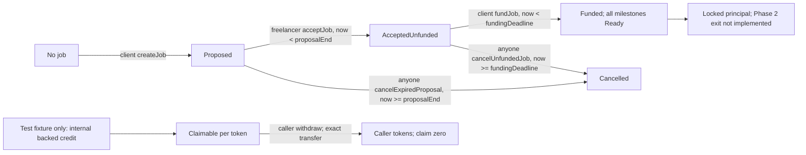

# Fairwork P0 state machine

Reopened Phase 4 presentation note: terminal milestones retain their dispute history and event-derived credit summary. Closing the final milestone closes the job; withdrawing credited funds is a separate action. Financial source bytes and these transitions are unchanged. A-17/A-59 keep early client cancellation/editing in Tier B; Tier A includes bounded proposal and funding expiry cancellation.

This document records the Phase 0 contract state model. The locked decisions in [`../DECISIONS.md`](../DECISIONS.md) govern behavior. The extra bounded exits and pool-edge rules are marked as assumptions; they must remain visible in the code and UI if implemented.

## State and time rules

- Job states are `Proposed`, `AcceptedUnfunded`, `Funded`, `Cancelled`, and `Closed`. `Funded` is the active state; there is no additional `Active` state.
- Milestone states are `Ready`, `Submitted`, `Rejected`, `Disputed`, and the terminal states `Released`, `Refunded`, and `Resolved`.
- `Claimable` and `Withdrawn` describe a user's token ledger, not milestone states. A withdrawal never changes a terminal milestone.
- At every window end `E`, the actor action requires `now < E`; the timeout/advance action requires `now >= E`. The first valid transaction that terminalizes a milestone wins.
- No settlement sends tokens to a beneficiary. It moves liability from locked milestone escrow to per-token claimable balances. Withdrawals transfer later.

## Job transitions

| From | Action | Caller | Guard | Effects and next state | Event |
| --- | --- | --- | --- | --- | --- |
| None | Create direct job | Client | Distinct nonzero parties; allowlisted token; 1–10 milestones; each demo amount 1–10^18 raw units; checked total at most 10×10^18; demo duration 1 second–365 days; valid commitments and revision bounds | Store terms and `createdAt`; set `proposalEnd = createdAt + fundingWindow` under A-01; `Proposed` | `JobCreated` |
| Proposed | Cancel proposal (F-04, Tier B; not authorized) | Client | Job remains `Proposed` | Mark terminal; no funds move; `Cancelled` | `JobCancelled` |
| Proposed | Accept | Named freelancer | `now < proposalEnd` | Store `acceptedAt` and `fundingDeadline = acceptedAt + fundingWindow`; `AcceptedUnfunded` | `JobAccepted` |
| Proposed | Expire proposal | Anyone | A-01: `now >= proposalEnd` | Mark terminal; no funds move; `Cancelled` | `JobCancelled` |
| AcceptedUnfunded | Fund | Client | `now < fundingDeadline`; exact requested balance delta equals total milestone amount; token and configuration checks pass; production config has at least 5 allowlisted and 3 eligible arbiters after excluding both parties | Lock the full total; set `fundedAt`; for each milestone set `deadline = fundedAt + duration` and `graceEnd = deadline + gracePeriod`; `Funded` | `JobFunded` |
| AcceptedUnfunded | Expire funding window | Anyone | `now >= fundingDeadline` | Mark terminal; no funds move; `Cancelled` | `JobCancelled` |
| Funded | Close job | Same transaction that settles the last milestone | Every milestone is `Released`, `Refunded`, or `Resolved` | `Closed`; no additional token movement | `JobClosed` |
| Cancelled or Closed | Any job action except reading state | Anyone | Job is terminal | Revert; cannot reopen or fund | None |

Each milestone has its own amount, duration, deadline, and revision counter. Milestones run independently and in parallel. An unresolved dispute freezes only that milestone's principal; other milestones continue under their own clocks.

## Milestone transitions

| From | Action | Caller | Guard | Effects and next state | Event |
| --- | --- | --- | --- | --- | --- |
| Ready | Submit | Freelancer | `now < graceEnd`; nonzero deliverable commitment | Append version 1 (or next version after a rejection); set `submittedAt` and `reviewEnd = submittedAt + reviewWindow`; `Submitted` | `MilestoneSubmitted` |
| Ready | Missed-delivery refund | Anyone | `now >= graceEnd` | Credit full milestone amount to client's claimable ledger; terminal `Refunded` | `MilestoneRefunded`, `ClaimableCredited` |
| Submitted | Approve | Client | `now < reviewEnd` | Credit full amount to freelancer's claimable ledger; terminal `Released` | `MilestoneApproved`, `ClaimableCredited` |
| Submitted | Reject | Client | `now < reviewEnd`; `rejectionCount < revisionLimit`; nonzero reason commitment | Increment this milestone's rejection count; set `rejectedAt`, `responseEnd = rejectedAt + responseWindow`; `Rejected` | `MilestoneRejected` |
| Submitted | Auto-release after silence | Anyone | `now >= reviewEnd` | Credit full amount to freelancer's claimable ledger; terminal `Released` | `MilestoneAutoReleased`, `ClaimableCredited` |
| Submitted | Open dispute | Client | `now < reviewEnd`; dispute has never opened for this milestone | Take opener deposit `D`; freeze this milestone; start evidence window; `Disputed` | `DisputeOpened` |
| Rejected | Resubmit | Freelancer | `now < responseEnd` | Append next version; keep rejection count; set new `submittedAt` and `reviewEnd`; `Submitted` | `MilestoneSubmitted` |
| Rejected | Open dispute | Client or freelancer | `now < responseEnd`; dispute has never opened for this milestone | Take opener deposit `D`; freeze this milestone; start evidence window; `Disputed` | `DisputeOpened` |
| Rejected | Rejection-window refund | Anyone | `now >= responseEnd` | Credit full amount to client's claimable ledger; terminal `Refunded` | `MilestoneRefunded`, `ClaimableCredited` |
| Disputed | Settle ruling or fallback | Anyone | Required dispute phase has ended and settlement is not yet final | Compute split; settle deposits; credit ledgers atomically; terminal `Resolved` | `DisputeRuled` or `DisputeFallbackApplied`, `MilestoneResolved`, `ClaimableCredited` |
| Released, Refunded, or Resolved | Any milestone transition or second settlement | Anyone | Milestone is terminal | Revert; no second credit. A beneficiary may still withdraw its independent claimable balance | None |

`revisionLimit = 0` prevents every rejection. After the per-milestone limit is exhausted, the client may approve, open a dispute in an allowed window, or remain silent until auto-release. A rejection opens one response window; a dispute stops that refund timer. No terminal milestone can reopen.

## Dispute transitions

Dispute phases are bounded. `evidenceDeadline = disputeOpenedAt + evidenceWindow` under A-04. The opener must transfer `D = max(1, floor(amount × depositBps / 10,000))` when opening. The counterparty may transfer the same `D` once before the evidence deadline. Only the parties submit evidence, with a cap of five entries each under A-07. Evidence contents remain encrypted off-chain; the contract stores only hashes and short opaque references.

| From | Action/trigger | Caller | Guard | Effects and next state | Event |
| --- | --- | --- | --- | --- | --- |
| NotOpen | Open | Eligible party from milestone table | Eligible source state/window; no prior dispute; opener pays `D` | Freeze milestone; start evidence clock; `Evidence` | `DisputeOpened` |
| Evidence | Match deposit | Counterparty | `now < evidenceDeadline`; not already matched; exact `D` | Increase dispute-deposit liability; remain `Evidence` | `DisputeDepositMatched` |
| Evidence | Submit evidence | Client or freelancer | `now < evidenceDeadline`; own party cap not reached; reference is `bytes32` | Store commitment and opaque reference; remain `Evidence` | `EvidenceCommitted` |
| Evidence | Late evidence or deposit match | Party | `now >= evidenceDeadline` | Revert; no evidence or liability change | None |
| Evidence | Request Panel 1 | Anyone | `now >= evidenceDeadline` | Start a randomness draw excluding parties; `RandomnessPending1` | `PanelRequested` |
| RandomnessPending1 | Panel 1 delivered | Randomness adapter callback | Request ID matches active draw; `now < requestEnd`; three distinct eligible arbiters excluding parties | Snapshot panel; start commit window; `Panel1Commit` | `PanelSelected` |
| RandomnessPending1 | Retry randomness request | Anyone | `now >= activeRequestEnd`; fewer than two retries used | Issue next request ID for the same draw; stay pending | `RandomnessRetryRequested` |
| RandomnessPending1 | Third request times out or pool cannot supply a full panel | Anyone after timeout, or adapter result | Third request has `now >= activeRequestEnd`, or fewer than 3 eligible members are returned | Apply 5000-bps fallback; refund all posted deposits; terminal dispute settlement | `DisputeFallbackApplied` |
| Any randomness-pending phase | Stale, duplicate, or expired callback | Randomness adapter | Request ID is not active or `now >= requestEnd` | Ignore it; no state or accounting change | None |
| Panel1Commit | Commit vote | Assigned Panel 1 arbiter | `now < commitDeadline`; one commitment per assigned arbiter | Store address-bound commitment; remain `Panel1Commit` | `VoteCommitted` |
| Panel1Commit | Commit deadline with one or more missing commitments | Anyone | `now >= commitDeadline` | Start one aggregate bounded replacement draw for all missing slots; `ReplacementRandomnessPending` |
| Panel1Commit | No missing commitments at deadline | Anyone | `now >= commitDeadline` | Start reveal window; `Panel1Reveal` | `PanelPhaseAdvanced` |
| ReplacementRandomnessPending | Replacement draw delivered | Randomness adapter callback | Request ID matches active draw; `now < requestEnd` | Assign every distinct eligible replacement returned, up to the number of vacancies; leave any unfilled slots vacant; start one shared replacement commit window; `Panel1ReplacementCommit` |
| ReplacementRandomnessPending | Retry replacement draw | Anyone | `now >= activeRequestEnd`; fewer than two retries used | Issue next request ID for the aggregate replacement draw; stay pending | `RandomnessRetryRequested` |
| ReplacementRandomnessPending | Third request times out | Anyone | `now >= activeRequestEnd` on third request | Apply 5000-bps fallback; refund all posted deposits; terminal | `DisputeFallbackApplied` |
| Panel1ReplacementCommit | Replacement commit | Assigned replacement arbiter | `now < replacementCommitDeadline`; one commitment | Store commitment; remain in replacement phase | `VoteCommitted` |
| Panel1ReplacementCommit | Replacement window closes | Anyone | `now >= replacementCommitDeadline` | Start reveal window; uncommitted replacements cannot reveal; no further replacement; `Panel1Reveal` | `PanelPhaseAdvanced` |
| Panel1Reveal | Reveal vote | Assigned Panel 1 arbiter/replacement | `now < revealDeadline`; arbiter committed before the applicable commit deadline; valid commitment preimage; vote 0–10,000 bps; not already revealed | Store vote; remain `Panel1Reveal` | `VoteRevealed` |
| Panel1Reveal | Reveal deadline with 2 or 3 valid votes | Anyone | `now >= revealDeadline`; quorum met | 2 votes: floored mean; 3 votes: median; settle deposits; terminal | `DisputeRuled` |
| Panel1Reveal | Reveal deadline with fewer than 2 valid votes | Anyone | `now >= revealDeadline`; no quorum | Request one fresh Panel 2, excluding parties and every address ever assigned to Panel 1, including replacements; `RandomnessPending2` | `PanelRequested` |
| RandomnessPending2 | Panel 2 delivered | Adapter callback | Active request ID; `now < requestEnd`; three distinct eligible, fresh arbiters | Start Panel 2 commit window; `Panel2Commit` | `PanelRedrawn`, `PanelSelected` |
| RandomnessPending2 | Retry randomness request | Anyone | `now >= activeRequestEnd`; fewer than two retries used | Issue next request ID for Panel 2 draw; stay pending | `RandomnessRetryRequested` |
| RandomnessPending2 | Third request times out or fresh pool unavailable | Anyone after timeout, or adapter result | Third request has `now >= activeRequestEnd`, or fewer than 3 fresh eligible arbiters are returned | Apply 5000-bps fallback; refund all posted deposits; terminal | `DisputeFallbackApplied` |
| Panel2Commit | Commit vote | Assigned Panel 2 arbiter | `now < commitDeadline`; one commitment per arbiter | Store commitment; remain `Panel2Commit` | `VoteCommitted` |
| Panel2Commit | Commit deadline | Anyone | `now >= commitDeadline` | Start reveal; no replacements in Panel 2; `Panel2Reveal` | `PanelPhaseAdvanced` |
| Panel2Reveal | Reveal vote | Assigned Panel 2 arbiter | `now < revealDeadline`; arbiter committed before the commit deadline; valid commitment preimage; vote 0–10,000 bps; not already revealed | Store vote; remain `Panel2Reveal` | `VoteRevealed` |
| Panel2Reveal | Reveal deadline with 2 or 3 valid votes | Anyone | `now >= revealDeadline`; quorum met | 2 votes: floored mean; 3 votes: median; settle deposits; terminal | `DisputeRuled` |
| Panel2Reveal | Reveal deadline with fewer than 2 valid votes | Anyone | `now >= revealDeadline`; no quorum | Apply 5000-bps fallback; refund all posted deposits; terminal | `DisputeFallbackApplied` |
| Any terminal dispute phase | Open, match deposit, submit evidence, request another panel, commit, reveal, or settle again | Anyone | Dispute already settled | Revert; no reopening or duplicate credit. Beneficiaries may still withdraw their separately credited balances | None |

For each randomness draw, the initial request and each retry have distinct request IDs and its own `requestEnd`. The callback action is valid only when `requestId` is active and `now < requestEnd`. At `now >= requestEnd`, anyone may request the next retry if fewer than two retries have been used; otherwise anyone applies the 5000-bps fallback and refunds all posted deposits. Expired, duplicate, and superseded callbacks are ignored. These rules apply to Panel 1, the aggregate replacement draw, and Panel 2 (A-09).

### Ruling and deposit accounting

For amount `A` and freelancer share `b` bps, `F = floor(A × b / 10,000)` and `C = A - F`. `F + C` always equals `A`. An arbiter vote salt is public when the arbiter reveals the vote; it is a random protocol value that must never be reused as a private-content salt.

| Freelancer share | Party that forfeits | Deposit/payout treatment |
| --- | --- | --- |
| `b > 5000` | Client | Treasury receives up to `D` from the client's posted deposit. If the client posted none, deduct up to `D` from the client's ruling payout. Refund every un-forfeited posted amount. |
| `b < 5000` | Freelancer | Treasury receives up to `D` from the freelancer's posted deposit. If the freelancer posted none, deduct up to `D` from the freelancer's ruling payout. Refund every un-forfeited posted amount. |
| `b = 5000` | Both parties | Each forfeits `floor(D/2)`. If a party posted no deposit, deduct its forfeiture from that party's ruling payout, capped by the payout. Refund all remaining posted amounts. |
| No quorum/fallback | Nobody | Refund every posted deposit in full; make no treasury credit and deduct nothing from either ruling payout. |

Deposits never pay arbiters. P0 arbiter stake is zero, so no stake can be slashed in this phase. Treasury is fixed at deployment. Pool-exhaustion behavior follows assumptions A-02 and A-09; it does not create another retry loop.

## Time parameters

All values are seconds; all token amounts are raw units. Production values are proposals; production windows must be at least one hour. Demo values are local only and excluded from public builds.

| Parameter | Production proposal | Demo/local | Notes |
| --- | --- | --- | --- |
| Proposal window | Same duration as funding window (2 days) | 1 minute | A-01; starts at creation; acceptance only before end |
| Funding window | 2 days | 1 minute | Starts at acceptance |
| Review window | 7 days | 2 minutes | Starts at each submission |
| Grace period | 3 days | 1 minute | `graceEnd = deadline + gracePeriod` |
| Response window | 3 days | 1 minute | Starts at rejection |
| Evidence window | 3 days | 1 minute | A-04: starts at dispute opening |
| Commit / replacement commit / reveal | 2 days / 1 day / 2 days | 1 minute each | Panel 2 also has commit and reveal; no replacement |
| Randomness timeout | 1 day | 1 minute | Per draw; initial request plus at most 2 retries (A-09) |
| Offer expiry (Tier B) | 48 hours | 2 minutes | Each offer has an independent expiry |
| Revision limit | 0–5 | 0–5 | Per milestone |
| Maximum milestones per job | 10 | 10 | Bounded settlement work |
| Per-milestone amount | Deployment-configured per token | 1–10^18 raw units | Job total is at most 10×10^18 raw units in the demo; checked addition |
| Duration input | 1 hour–365 days | 1 second–365 days | A-12; deadline arithmetic is checked |
| Panel / quorum | 3 / 2 | 3 / 2 | Exclude parties and duplicates |
| Dispute deposit | 2%, min 1 raw unit | 2% | A-08: configured `depositBps` 1–10,000 |
| Evidence cap | 5 entries per party | 5 entries per party | Hash and opaque reference only |
| Arbiter registry cap | 128 | 128 | A-10 bounds registry/pool loops |
| Production arbiter minimum | 5 allowlisted and at least 3 eligible after excluding parties before funding | Seed 6 | Does not guarantee a full fresh Panel 2; bounded fallback applies |
| Supported tokens | MockUSDC (6 decimals), MockWBTC (8 decimals) | Plus 18-decimal test-only mock | Address, symbol, decimals from deployment output |
| Opaque reference | `bytes32` | `bytes32` | Not an arbitrary URL |
| Final-file threshold (Tier B) | 50% | 50% | Client gets final file only at or above threshold |

## Chain event list

Every event contains identifiers and commitments, never private text, raw file bytes, salts, personal data, or private URLs. The vote salt is intentionally public in the arbiter's reveal calldata but is not emitted as an event and is never reused for private content. Events must be sufficient to rebuild the tracker and explain each token-ledger movement.

| Event | Emitted for | Minimum useful fields |
| --- | --- | --- |
| `JobCreated` | Direct job creation | Job ID, client, freelancer, token address, total amount, terms commitments, milestone count |
| `JobAccepted` | Freelancer acceptance | Job ID, freelancer, accepted timestamp, funding deadline |
| `JobFunded` | Exact funding receipt | Job ID, token, total raw amount, funded timestamp |
| `JobCancelled` | Client cancel or proposal/funding expiry | Job ID, reason enum, caller, timestamp |
| `JobClosed` | Last milestone becomes terminal | Job ID, timestamp |
| `MilestoneSubmitted` | Initial submission and each resubmission | Job/milestone IDs, version, deliverable hash, opaque reference, submitted timestamp |
| `MilestoneApproved` | Client approval | IDs, amount, freelancer |
| `MilestoneRejected` | In-window rejection | IDs, rejection count, reason commitment, response end |
| `MilestoneAutoReleased` | Review silence | IDs, amount, freelancer |
| `MilestoneRefunded` | Missed-delivery or response timeout | IDs, amount, client, timeout kind |
| `MilestoneResolved` | Any ruling/fallback terminalizes a disputed milestone | IDs, ruling bps, freelancer/client amounts, outcome |
| `DisputeOpened` | First dispute opening | IDs, opener, disputed amount, deposit amount, evidence deadline |
| `DisputeDepositMatched` | Counterparty matches deposit | Dispute ID, payer, amount |
| `EvidenceCommitted` | Party evidence hash/reference | Dispute ID, submitter, commitment hash, opaque reference, ordinal |
| `PanelRequested` | Initial, aggregate replacement, or fresh-panel randomness draw | Dispute ID, panel number, vacancy count if any, provider request ID, request timestamp |
| `RandomnessRetryRequested` | Bounded retry for one draw | Dispute ID, draw ID, retry number, provider request ID |
| `PanelSelected` | Full panel selected | Dispute ID, panel number, three arbiter addresses |
| `PanelRedrawn` | Fresh Panel 2 or replacement selection | Dispute ID, panel number, replaced address(es) if any, selected address(es) |
| `PanelPhaseAdvanced` | Commit/replacement/reveal phase advances | Dispute ID, panel number, phase, phase deadline |
| `VoteCommitted` | Arbiter commitment | Dispute ID, panel number, arbiter, commitment hash |
| `VoteRevealed` | Valid vote reveal | Dispute ID, panel number, arbiter, basis-point vote |
| `DisputeRuled` | Quorum ruling | Dispute ID, panel number, valid vote count, ruling bps, freelancer/client split |
| `DisputeFallbackApplied` | No-quorum, randomness, or pool fallback | Dispute ID, reason enum, 5000 bps, deposit-refund total |
| `DisputeDepositSettled` | Deposit refund/forfeiture accounting | Dispute ID, payer, refunded, forfeited, treasury |
| `ClaimableCredited` | Any settlement credit | Token, beneficiary, raw amount, source job/milestone/dispute, reason enum |
| `WithdrawalCompleted` | Pull withdrawal | Token, account, raw amount, recipient |
| `ArbiterAdded` / `ArbiterRemoved` | Registry change | Arbiter address, caller, timestamp; removal affects future panels only under A-06 |
| `TokenConfigured` | Constructor allowlist entry | Token address, symbol, decimals, raw-unit min/max |
| `ParameterConfigured` | Constructor-time deployment configuration only | Parameter key and value; emitted once per configured parameter |

## Diagram

```mermaid
flowchart LR
  subgraph Job
    P[Proposed] -->|freelancer accepts before proposalEnd| U[AcceptedUnfunded]
    P -->|client cancels or A-01 expiry| X[Cancelled]
    U -->|client funds before fundingDeadline| F[Funded / active]
    U -->|funding timeout| X
    F -->|all milestones terminal| C[Closed]
  end

  subgraph Milestone
    R[Ready] -->|submit before graceEnd| S[Submitted]
    R -->|graceEnd timeout| RF[Refunded]
    S -->|approve or reviewEnd silence| RL[Released]
    S -->|reject with revisions left| J[Rejected]
    S -->|client disputes before reviewEnd| D[Disputed]
    J -->|resubmit before responseEnd| S
    J -->|either party disputes before responseEnd| D
    J -->|responseEnd timeout| RF
    D -->|ruling or fallback| RS[Resolved]
  end

  subgraph Dispute
    E[Evidence] -->|evidenceDeadline| Q[Randomness request]
    Q -->|Panel 1 selected| C1[Panel 1 commit]
    C1 -->|missing commits at deadline| QR[One aggregate replacement draw]
    QR -->|randomness returns available replacements| RC[Shared replacement commit window]
    QR -->|randomness timeout| FB
    QR -->|pool short, leave vacancies empty| RC
    C1 -->|no replacement needed| V1[Panel 1 reveal]
    RC -->|replacement window closes| V1
    V1 -->|2 or 3 reveals| R1[Rule and settle]
    V1 -->|fewer than 2| Q2[Fresh Panel 2 request]
    Q2 -->|Panel 2 selected| C2[Panel 2 commit]
    C2 -->|commit deadline| V2[Panel 2 reveal]
    V2 -->|2 or 3 reveals| R2[Rule and settle]
    V2 -->|fewer than 2| FB[5000 bps, refund deposits]
    Q -->|request/pool fallback| FB
    Q2 -->|request/pool fallback| FB
  end

  RL --> L[Claimable ledger]
  RF --> L
  RS --> L
  L -->|withdraw(token)| W[Tokens transferred]
  W --> N[Milestone status stays Released, Refunded, or Resolved]
```

## Phase 0 caveats

The source brief and `fairwork_v3_spec.md` referenced by the supplied README were not included in the provided files, so their seven-feature wording cannot be independently checked here. A-13 resolves the raw-salt wording as a public vote-only reveal exception; private-content salts remain off-chain and vote salts are never reused. The production randomness provider retry restriction is documented separately in [`RANDOMNESS_PLAN.md`](RANDOMNESS_PLAN.md).

## Historical Phase 1 subset (A-17/A-22)

The tables and full diagram above are the target P0 design, not a claim that all transitions exist. The following diagram records the Phase 1 foundation at its completion; early client cancellation is F-04/Tier B, all delivery/settlement transitions are later phases, and there is no Closed transition yet.



Actual event ABI:

| Event | Fields |
| --- | --- |
| JobCreated | jobId, client, freelancer, token, totalAmount, milestoneCount, createdAt, proposalEnd |
| JobAccepted | jobId, acceptedAt, fundingDeadline |
| JobFunded | jobId, totalAmount, fundedAt |
| JobCancelled | jobId |
| ClaimableCredited | token, account, amount; test fixture only until settlement exists |
| WithdrawalCompleted | token, account, amount; account is always recipient |

Agreement commitments are read through getJobCommitments; each milestone's immutable terms through getMilestone. A-22 records compact creation/cancellation events and the later indexer obligation; source/reason metadata for settlement credits and constructor configuration events from the full target catalog are not implemented. Constructor configuration remains readable through getters; no live indexer exists. Every Phase 1 mutator is nonReentrant, and cancellation moves no funds. The Phase 1 invariant excludes disputes/stakes because those liabilities do not exist yet.

## Current implemented Phase 2 subset (A-23 through A-27)

The current seven delivery/review/refund transitions and Closed job transition are in [PHASE2_STATE_MACHINE.md](PHASE2_STATE_MACHINE.md). Phase 1 create/accept/fund/cancel/withdraw remains compatible; its old locked-principal arrow above is historical. Real production settlement now emits ClaimableCredited plus MilestoneSettlementCredited and the terminal cause event. Full arbitration diagrams remain future Phase 3 target behavior.

Current additional event ABI:

| Event | Fields |
| --- | --- |
| MilestoneSubmitted | indexed jobId, indexed milestoneIndex; version, deliverableHash, opaqueReference, submittedAt, reviewEnd |
| MilestoneRejected | indexed jobId, indexed milestoneIndex; rejectionCount, reasonCommitment, rejectedAt, responseEnd |
| MilestoneApproved | indexed jobId, indexed milestoneIndex; amount, freelancer |
| MilestoneAutoReleased | indexed jobId, indexed milestoneIndex; amount, freelancer |
| MilestoneRefunded | indexed jobId, indexed milestoneIndex; amount, client, timeoutKind |
| MilestoneSettlementCredited | indexed jobId, indexed milestoneIndex, indexed token; account, amount, reason |
| JobClosed | indexed jobId |

Settlement reason codes are Approval=0, ReviewSilence=1, MissedDelivery=2, RejectionSilence=3. Refunded timeoutKind uses 2 or 3. JobClosed means all milestones terminal; claims can still await withdrawal. Constructor configuration events and a live indexer remain absent. The final Phase 2 report records measured verification, not a full P0 completion claim.

## Phase 3 implemented model

See PHASE3_STATE_MACHINE.md and PHASE3_API.md for the actual local arbitration phases, events and exact ABI. The immutable arbitration engine emits panel/evidence/vote events; escrow emits deposits and money settlement events, so consumers must index both addresses. Callbacks store entropy only; advance selects panels and starts their clocks. Prior target callback-assignment descriptions are superseded by this model. Final source verification and gate results are recorded in PHASE3_REPORT.md.
