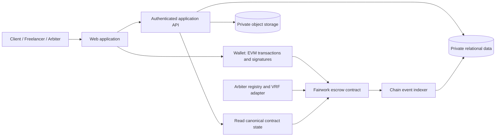

# Fairwork v3 — Implementation Guide

This guide turns [`spec.md`](./spec.md) into an implementation sequence and a set of concrete boundaries. Phase 0 chose a local stack and repository layout; the exact pins are recorded in `DECISIONS.md` A-14 through A-16 and the manifests/lockfile. This document remains the source-derived implementation guide, with Phase 0 clarifications called out where they supersede ambiguous source prose.

## 1. Implementation principles

1. **Treat `spec.md` as the behavioral source of truth.** Update it before changing money movement, states, deadlines, signatures, or privacy behavior.
2. **Ship the escrow path before marketplace polish.** Implement and prove acceptance, funding, delivery, timeout, payout, and dispute accounting before building listings and chat.
3. **Keep chain and application responsibilities separate.** The contract decides payment rights. The backend stores listings and private data and indexes events; it does not approve payments.
4. **Use explicit, finite state transitions.** Every public contract action has a caller rule, state precondition, time rule, effects, emitted event, and test.
5. **Prefer reversible, bounded operations.** Use pull payments, bounded arrays, fixed panel size, bounded evidence count, and explicit timeout exits.
6. **Do not make hidden product decisions in code.** Follow the locked decisions in `spec.md` §11 and assumptions in §12; §10 is a historical list marked superseded.

## 2. Proposed system boundaries



### 2.1 Trust boundaries

- **Escrow contract:** owns accepted ERC-20 deposits and enforces all payment transitions. Keep it non-upgradeable for the initial release. No website administrator can write user payout balances.
- **Wallet:** signs every user-controlled agreement, offer, amendment, and transaction. The web app displays readable terms, target chain, contract address, recipient, token, amount, and effect before asking for a signature.
- **API/database:** manages auth sessions, listings, offers/chat metadata, moderation, private files, and derived views. It may be writable for those domains, but is read-only with respect to contract outcome; read contract state directly or verify indexed state against the chain before serving payment-sensitive content.
- **File service:** stores preview, final, and evidence files outside a public web root. It authorizes every request and uses short-lived links. Never place private files at guessable public URLs.
- **Indexer:** consumes contract events and can be rebuilt. It is not the sole source for a transaction decision.
- **VRF:** isolates randomness behind a small adapter. Production panel selection must use the selected verifiable randomness service; a local mock is a test/demo aid only.

## 3. Suggested repository layout

The Phase 0 layout choice is A-15: use a single Next.js app in `apps/web` and put future API handlers inside that app; a separate `apps/api` package is not part of the scaffold. Local relational storage uses Prisma with SQLite. Route business behavior remains deferred until its authorized phase.

```text
contracts/
  src/                  escrow, token registry, arbiter/VRF adapter as needed
  test/                 unit, state-transition, invariant, and hostile-token tests
  script/               local deploy and deterministic seed scripts
  lib/                  pinned dependency submodules if used
README.md               project overview and runnable setup/demo instructions
spec.md                 canonical behavior and requirement IDs
implementation.md       build sequence and technical boundaries
apps/
  web/                  wallet UI and public/private marketplace screens
packages/
  shared/               schemas, typed event definitions, formatting only
  chain/                ABIs, addresses, chain reads, transaction helpers
infra/
  local/                local-only database/storage/service configuration
```

Do not put deploy keys, production credentials, user uploads, or generated local secrets in source control. Add a real `.env.example`, `.gitignore`, and secret-scanning configuration when the stack is selected.

## 4. Contract design

### 4.1 Contract scope

Start with one escrow contract and many jobs keyed by monotonically assigned job ID, as recommended in the source. Separate token/arbiter helper contracts only when needed for clear access control or external VRF integration. Avoid proxies and upgrades in the first version.

The contract should hold only approved token liabilities. User withdrawals are pull-based. Keep all loops bounded by configured maximum milestones (example: 10), fixed panel size (3 for P0), and evidence cap (5 entries per party).

### 4.2 Data model (logical)

```text
Job
  client, freelancer, token
  state: Proposed | AcceptedUnfunded | Funded | Cancelled | Closed
  createdAt, proposalEnd, acceptedAt, fundingDeadline, fundedAt
  descriptionCommitment, scopeCommitment
  revisionLimit, maxMilestones, milestoneCount
  offerNonce/offerHash where created from signed offer

Milestone
  amount (raw token units), acceptanceCriteriaCommitment
  duration in seconds, deadline, graceEnd, reviewEnd, responseEnd
  deadline, graceEnd, reviewEnd, disputeEnd
  state, rejectionCount, submissionVersion
  settledFreelancerBps, outcome

Submission[] (bounded to revisionLimit + 1 entries per milestone under D-04)
  version, deliverableHash, opaqueReference, submittedAt

Dispute
  milestoneId, opener, state, evidenceDeadline
  panel[3], replacement/redrawRound, commitDeadline, revealDeadline
  commitment[arbiter], revealedBps[arbiter], revealCount
  depositAccounting and final ruling

Token ledger by token
  lockedEscrow, claimable[user], disputeDeposits, arbiterStakes
```

Store only what contract enforcement needs. Do not place private description text, acceptance criteria, names, emails, file bytes, raw salts, or private signed URLs in storage/events. For text commitments, use salted commitments; define which serialization and hash algorithm the client must reproduce.

Under D-04, `revisionLimit` is negotiated for the job but enforced independently per milestone. Store a separate `rejectionCount` on each milestone and cap that milestone's submission history at `revisionLimit + 1` entries. Never consume one shared job-wide counter.

### 4.3 State ownership and accounting

Keep each milestone's settlement terminal and separate from the beneficiary's withdrawal. Example conceptual accounting for one token:

```text
lockedEscrow[token] + sum(claimable[token][user])
  + disputeDeposits[token] + arbiterStakes[token]
  <= token.balanceOf(escrow)
```

The inequality is intentional: direct/forced token transfers may create unassigned excess. Such transfers must not mint claimable balances or corrupt obligations. The internal ledger is authoritative for who owns funds. Emit an event if excess is detected only if it can be done without unbounded per-user work.

Every settlement changes locked liabilities into claimable liabilities exactly once. A withdrawal changes claimable liabilities and token balance together. Use token-specific accounting; never compare or sum raw units from different tokens.

### 4.4 Suggested external function surface

Names are illustrative; selectors and parameters should follow the final data model.

| Operation | Caller | Key preconditions/effects |
| --- | --- | --- |
| `createJob(...)` | Client | Valid parties/token/milestones/limits; creates `Proposed` direct job |
| `acceptJob(jobId)` | Named freelancer | Job is `Proposed`; records acceptance and funding deadline |
| `cancelUnacceptedJob(jobId)` | Client | Still proposed and not funded |
| `cancelUnfundedJob(jobId)` | Anyone | Accepted, unfunded, and funding window expired |
| `fundJob(jobId)` | Client | Accepted, before funding deadline; exact total token amount received; set funded time/deadlines |
| `submitMilestone(jobId, milestoneId, hash, reference)` | Freelancer | Funded/eligible, before submission cutoff; append version, start review window |
| `approveMilestone(...)` | Client | Submitted and before review end; settle 100% to freelancer claimable |
| `rejectMilestone(..., reasonCommitment)` | Client | Submitted, review window open, revision capacity remains; increment count and open rejection window |
| `resubmitMilestone(...)` | Freelancer | Rejected and within permitted window; append next version and restart review |
| `releaseAfterSilence(...)` | Anyone or freelancer | Submitted and review window expired; settle to freelancer |
| `refundAfterMissedDeadline(...)` | Anyone or client | No submission and grace ended; settle to client |
| `refundAfterRejectionWindow(...)` | Anyone or client | Rejected and required dispute/resubmission window expired, unless a valid dispute is active |
| `openDispute(...)` | Eligible party | Eligible milestone state; take deposit(s) exactly once; freeze milestone |
| `submitEvidence(...)` | Party/assigned arbiter | Correct dispute role, evidence window open, below cap |
| `requestPanel(...)` | Permissionless/authorized automation | Evidence phase complete; request VRF panel; exclude parties/duplicates |
| `commitVote(...)` / `revealVote(...)` | Assigned arbiter | Correct phase and deadlines; commit binds all required identifiers |
| `advanceDispute(...)` | Anyone | Permissionless bounded phase transition/slash/replacement/fallback; funds only to rightful beneficiaries |
| `withdraw(token)` | Account with claimable value | Zero balance before transfer; reentrancy guard; transfer exactly owed amount |
| `acceptOffer(offer, signature)` | Named counterparty | EIP-712 valid, unexpired, uncancelled, unused, bounded terms; create accepted unfunded job |
| `cancelOffer(offerHash)` | Offer signer | Marks that exact offer unusable; cannot alter already created job |
| `executeAmendment(amendment, signatures)` | Either party submits both signatures | EIP-712 valid, unused, unexpired; affected milestones have not started/are not disputed/paid; token accounting for increase/decrease is atomic |

Avoid one catch-all function that accepts caller-supplied status. Each transition should be a distinct guarded operation or an internal helper behind role-checked methods.

### 4.5 Event design

Emit enough data for a complete audit feed without leaking private content. Suggested events:

- `JobCreated`, `JobAccepted`, `JobFunded`, `JobCancelled`
- `MilestoneSubmitted`, `MilestoneRejected`, `MilestoneApproved`, `MilestoneAutoReleased`, `MilestoneRefunded`
- `DisputeOpened`, `EvidenceCommitted`, `PanelRequested`, `PanelSelected`, `VoteCommitted`, `VoteRevealed`, `PanelRedrawn`, `DisputeRuled`, `DisputeFallbackApplied`
- `ClaimableCredited`, `WithdrawalCompleted`
- `OfferAccepted`, `OfferCancelled`, `AmendmentExecuted`
- `ArbiterAdded/Removed`, `ArbiterSlashed`, `StakeWithdrawn`, `ParameterConfigured`

Events should use job/milestone/dispute identifiers and commitment hashes/opaque references only. Do not emit arbitrary user prose or private file locations.

### 4.6 Transfer and signature details

- Pin Solidity and library versions in the lockfile/build config. Compile with checked arithmetic.
- Use SafeERC20-equivalent wrappers; reject zero addresses, zero values, self-dealing parties, unsupported tokens, and invalid bps.
- On deposit, compare before/after balances for the escrow address; require exact receipt.
- On withdrawal, clear claimable storage before calling `transfer`; guard all external token calls against reentrancy.
- Use EIP-712 domain separation with chain ID and contract address. For offers/amendments include signer, named counterparty, job/listing context, token, raw amount, delivery term, revisions, scope commitment, nonce, expiry, and any protocol-config version needed to prevent ambiguity.
- Track used/cancelled signatures. A signature is not safe merely because it has an expiry. Test wrong chain, wrong contract, replay, signer cancellation, expired offer, and wrong counterparty.
- Token allowances in the UI are exact to the required funding amount and are never unlimited.

## 5. Deadline and dispute execution

### 5.1 Funding and delivery clock

1. Acceptance records `acceptedAt` and `fundingDeadline = acceptedAt + fundingWindow`.
2. Funding is valid only before the funding deadline under the locked half-open convention in `spec.md` §3.4. It transfers the full total and records `fundedAt`.
3. Delivery deadline(s) are computed from the agreed duration rule and `fundedAt`, not `acceptedAt`.
4. No submission is accepted at or after the configured grace end. The permissionless refund transition becomes available at that same point.
5. A public timeout call may advance state, but cannot choose the beneficiary; the contract computes the rightful recipient.

The locked scheduling decision is D-01 in `spec.md` §11: each milestone stores an independent duration in seconds; at funding, `deadline = fundedAt + duration` and `graceEnd = deadline + gracePeriod`. Milestones run in parallel and have no predecessor dependency.

### 5.2 Review and revisions

For each submission, record a unique increasing version and start a review interval. Approval and rejection are valid only while that interval is open. At or after its end, auto-release is available. A rejection increments the applicable counter only after validating that capacity remains. The contract must not offer a reject path once the chosen shared-job or per-milestone revision cap is exhausted.

Rejection reason content stays off-chain and readable by the freelancer; the commitment on-chain binds that content. Use A-13's typed, domain-tagged Keccak-256 encoding and fresh private-content salt. The separate vote-reveal salt is intentionally public in reveal calldata and must never be reused for private content.

### 5.3 Bounded arbiter flow

The P0 flow should have a fixed number of steps and no unbounded retry:

1. Open dispute once; freeze only the disputed milestone's escrow amount. Apply D-02's opener deposit and optional counterparty match exactly; a milestone cannot be disputed a second time.
2. Allow up to the configured evidence count per party until `evidenceDeadline`.
3. Request panel selection through the randomness adapter; select three distinct eligible arbiters excluding both parties. Store each request ID. The local mock is DEMO ONLY. Production Chainlink VRF v2.5 integration remains blocked pending provider-safe retry semantics; do not claim it is production-ready. See `docs/RANDOMNESS_PLAN.md`.
4. Run a commit phase, then a reveal phase. Commit hash includes `chainId`, `contractAddress`, `disputeId`, `arbiter`, `bps`, and `salt`.
5. At the Panel 1 commit deadline, make one aggregate draw for all missing-commit vacancies. If it returns replacements, start one shared replacement commit window after that callback; no second replacement is attempted. A successful draw that cannot fill every vacancy assigns the available eligible replacements and leaves other seats empty. If the draw itself times out after its bounded attempts, apply the 50/50/refund fallback.
6. At reveal deadline, count valid reveals. With at least two, rule: three votes → median; two votes → floor average. P0 arbiter stake is zero; no stake can be slashed in this phase.
7. With fewer than two, draw one entirely fresh Panel 2 excluding both parties and every address ever assigned to Panel 1, including replacements. Repeat commit/reveal with no replacements. If a full fresh panel cannot be drawn, the randomness attempts time out, or Panel 2 lacks quorum, settle 50/50 and refund all posted deposits.
8. Credit claimable balances and terminalize dispute/milestone atomically. The treasury receives only explicitly forfeited deposits under the final deposit policy; it never receives escrow principal by admin command.

Use a permissionless `advance`/`finalize` action for timeouts so a crashed frontend or inactive operator cannot strand a dispute. Every advancement checks deadlines and can happen only once per phase.

### 5.4 Ruling arithmetic

With two valid votes `a` and `b`, set `rulingBps = floor((a + b) / 2)`. With three valid votes, sort exactly three bounded values and choose the middle. Calculate:

```text
freelancerShare = floor(milestoneAmount * rulingBps / 10_000)
clientShare = milestoneAmount - freelancerShare
```

Use 256-bit intermediate checked arithmetic or a reviewed full-precision `mulDiv` implementation if supported values could overflow. Fuzz all basis points and odd amounts. Never round the client share independently.

## 6. Off-chain implementation

### 6.1 Authentication and authorization

- Sign-In with Ethereum issues a one-use, expiring nonce; server verifies wallet signature and expected domain/URI/chain before opening a session.
- Store session server-side; set `HttpOnly`, `Secure`, and `SameSite` cookies with short expiry. Rotate at login and invalidate at logout.
- Every read/write route checks the authenticated wallet against job role or assigned arbiter for the requested object. Never trust an ID, listing slug, hidden URL, frontend role, or indexer response as access control.
- Reviewers use a separate protected role. Log every access to private evidence/chat. Avoid exposing reviewer endpoints to normal users.
- Rate-limit login, offers, chat, reports, uploads, and all public APIs.

### 6.2 Suggested relational entities

Use a relational database with constraints/foreign keys and parameterized queries. The following is a logical model, not a required schema:

```text
WalletAccount(wallet, created_at, ban_state, session metadata)
Listing(id, owner_wallet, public fields, token, starting_amount, revisions, status)
Thread(id, listing_id, client_wallet, freelancer_wallet, status, created_at)
Message(id, thread_id, sender_wallet, encrypted_body, created_at)
Offer(id, thread_id, signer, counterparty, typed_payload, signature, hash,
      nonce, expiry, chain_state, created_at)
PrivateJobData(job_id, encrypted_scope, criteria, salt references, retention_at)
FileObject(id, job_id, owner, kind, storage_key, content_hash, access_state)
EvidenceObject(id, dispute_id, submitter, hash, storage_key, created_at)
ModerationSignal(id, wallet, job_id, source_event, created_at, unique source key)
ReviewCase(id, wallet, status, assigned_reviewer, decision, reason, timestamps)
AuditEntry(id, actor, subject, action, source, timestamp, metadata)
ChainEvent(chain_id, contract, tx_hash, log_index, block, event_type, payload)
```

Use unique constraints for event identity and signal source to prevent duplicate indexing. Treat stored signatures and signed offer payloads as untrusted until verified. Store token raw values as integer/decimal-safe strings or database integer types large enough for `uint256`; never JavaScript floating-point numbers.

### 6.3 File pipeline

1. Validate authenticated role, declared size, and allowed purpose before accepting upload.
2. Generate a random storage key; inspect file type by bytes, not extension alone; reject active HTML/SVG and enforce size limits.
3. Store outside the web root with encryption at rest. For P1 client-side encryption, use WebCrypto AES-GCM and define how keys are shared with the counterparty and assigned arbiters before enabling it.
4. Compute/verify SHA-256 in the browser for deliverables. The server may independently hash received bytes but must not claim local hashing means the server never saw a file when a file was uploaded.
5. Keep preview, final, and evidence objects in distinct access classes. Final download checks current chain state and the configured ruling threshold on each request, then returns a short-lived attachment URL.
6. Never fetch user-provided URLs from the server. Evidence links open only after showing the destination domain and using safe browser attributes.
7. Apply deletion/retention jobs, but disclose that on-chain commitments/events cannot be removed.

### 6.4 Indexing and audit trail

- Ingest contract events with `(chainId, contractAddress, txHash, logIndex)` as the unique key.
- Handle chain reorganizations by tracking block hash/finality and replaying from a known checkpoint.
- Reconcile any payment-sensitive UI state against a canonical contract read after the transaction receipt; refetch after each receipt.
- Merge chain events and off-chain audit events chronologically, clearly labeling origin and finality. Never rewrite chain history; append correction events for off-chain administrative corrections.
- Export JSON/CSV from this ordered, authorized view only.

## 7. Frontend behavior

- Gate buttons using connected wallet, chain ID, job role, state, and timestamps. These are usability controls only; the contract still validates each call.
- Show state and action consequences before approve, reject, dispute, cancel, offer acceptance, amendment, and withdrawal.
- Before signatures/transactions show token symbol **and address**, raw amount and formatted amount, parties, delivery term, revision count, scope summary/hash, contract address, chain, and expiry where relevant.
- Use exact ERC-20 allowance. Clearly distinguish wallet token balance, locked escrow, claimable balance, and withdrawn total.
- Disable submit while a transaction is pending; show pending/confirmed/failed; decode known custom errors into plain language without hiding the raw diagnostic from developer logs.
- Never trust locally cached state for money actions. Wait for receipt and reread chain state.
- Display all user text as text; validate/sanitize links and markdown; never execute HTML from chain or database content.
- Local wallet switcher, seed/reset actions, and time warp require a dev-only build flag and must be absent from public bundles/routes.

## 8. Build sequence and exit gates

**Phase-order precedence:** this guide's original section 8 used a different numbering: it placed marketplace/off-chain security work in its Phase 5 and extensions in Phase 6. For this project, follow the authoritative phase order in `HERO_PROMPT.md` §8: Phase 0 scaffold; Phase 1 escrow; Phase 2 delivery/exits; Phase 3 disputes; Phase 4 read UX/local demo/Attack Lab; Phase 5 independent adversarial review, fixes, and release evidence. Marketplace/signature features are Tier B and must not begin before the Tier A gate and an explicit `GO TIER B <item>`. The section 8 marketplace and extension paragraphs below describe later possible work, not the active Phase 5 gate.

### Phase 0 — Lock rules and scaffold

- Resolve `spec.md` §10 decisions that affect P0 state, deposits, timing, tokens, and disputes.
- Choose chain, compiler/library versions, frontend/API/database/storage stack, VRF plan, and local chain.
- Create threat-modelled config and test harness. Pin dependencies and add secret hygiene before deployment keys exist.

**Exit gate:** reviewed state-transition diagram and parameter table; clean minimal compile; no unresolved money-path decision.

### Phase 1 — Escrow foundation (F-01–F-03)

- Implement job creation/acceptance/funding, token allowlist, raw-unit accounting, milestone cap, events, and role checks.
- Add exact balance-delta checks, pull-payment ledger, and guarded withdrawal foundation even if release paths land later.

**Exit gate:** direct create/accept/fund path; wrong-role/invalid-input/odd-token tests; per-token solvency invariant holds.

### Phase 2 — Delivery and exits (F-10–F-24, F-85/F-86)

- Implement submission history, review, revision count, approval, rejection, resubmission, late grace submission, auto-release, missed-deadline refund, and post-rejection timeout.
- Implement shared deadline helpers to avoid divergent boundary checks.

**Exit gate:** every transition and illegal transition tested; boundary matrix one second before/at/after each deadline; no stuck-state model.

### Phase 3 — Disputes (F-30–F-35, F-45)

- Implement registry checks, evidence caps, VRF abstraction, panel exclusion, commit/reveal, vote math, slash/replacement/redraw/fallback, and deposit ledger under locked policy.

**Exit gate:** full dispute scenario plus no-show/fallback scenarios; invariant and reentrancy/failure tests; human line-by-line review of ruling and payout methods.

### Phase 4 — Audit/read UX and local demo (F-50/F-51, F-60–F-74)

- Build contract-driven tracker, role/state UI, transaction feedback, wallet/network checks, local seed/reset and time warp, README/demo script, and Attack Lab.
- Implement the D-11 Tier A/P0 privacy baseline: SIWE authentication; private job text stored only as salted commitments on-chain; private deliverables/evidence behind role-checked authorization; server-side AES-256-GCM encryption at rest using an environment-provided master key; a script to delete eligible off-chain data 90 days after closure or on request; and reviewer/arbiter access logs. Do not claim end-to-end encryption. Broader chat/offer retention and client-side encryption remain later Tier B work.
- F-74's backup demo video is a human deliverable due by the source brief's hour-16 deadline; schedule a person to record and verify it rather than claiming an agent produced it.

**Exit gate:** end-to-end demo on local chain; deterministic reset; demo-only routes excluded from production build.

### Phase 5 — Independent adversarial review and release evidence

- Freeze feature work and review the contract, state transitions, token accounting, privacy boundaries, randomness behavior, deployment configuration, and Phase 4 demo independently against the locked spec and threat model.
- Fix every Critical/High finding, document accepted residual risks, rerun the affected checks, and preserve reproducible build/test/secret-scan evidence. Production randomness remains blocked until its provider-safe retry/fallback design is approved and validated.
- Confirm the human-owned F-74 video deliverable and the Tier A/P0 privacy acceptance evidence before calling the release gate complete.

**Exit gate:** independent review is complete; no unresolved Critical/High finding; fixes and residual risks are documented; the release evidence is reproducible; actual production integration limits are stated without overclaiming.

### Later Tier B — Marketplace and off-chain security (F-80–F-84; P/W/X controls)

- Add listings, private threads, signed offer flow, broader chat/offer moderation and retention controls, client-side encryption only after key exchange/recovery is specified, and indexer extensions. SIWE, role-checked private data access, AES-256-GCM at-rest encryption, D-11 retention script, and reviewer/arbiter access logs are Phase 4 Tier A/P0 foundations, not deferred to this tier.
- Keep offer acceptance and contract job creation atomic. Preserve explicit per-offer cancellation/expiry/replay semantics.

**Exit gate:** listing-to-funded-job flow; two-account IDOR suite; offer abuse suite; upload/final-file access tests; security headers and secret checks.

### Later Tier B/C extensions

- Amendments, file verification/IPFS, preview/final release, signals/review queue/bans, salary/stakes/coherence, appeal, exports, testnet, blocklist, ban appeal, and paid extra revisions.

**Exit gate:** each extension has updated spec, migration/privacy behavior, security review, and targeted regression tests.

## 9. Test and security plan

Tests are part of implementation, not a final polish step. Associate each case with requirement IDs in test names or comments.

### 9.1 Contract tests

- Unit tests for every successful transition and each exact role/state failure.
- Time tests at `end - 1`, `end`, and `end + 1` for funding, delivery/grace, review, evidence, commit, reveal, offer, amendment, and appeal windows.
- Fuzz split math, raw amounts, bps, milestone count, call ordering, and supported token decimals (6, 8, 18); include odd amounts and max values.
- Invariants: balance per token ≥ ledger liabilities; no duplicate settlement; total credits equal settled principal plus/minus explicit deposits/fees; no admin path moves user liabilities; every reachable nonterminal state has an eventual bounded exit.
- Hostile tokens/receivers: reentrant callback, revert-on-transfer receiver, false-return token, fee-on-transfer token, malformed decimals, paused/blacklisting behavior where practical.
- Offer/amendment: wrong signer/counterparty/chain/contract, expiry, cancellation, replay, nonce collision, stale old offer, invalid price/revisions.

### 9.2 Application security tests

- Two-account authorization matrix for every API route, including listing, job, chat, evidence, review, offer, and file routes.
- SIWE nonce replay/expiry and cookie flag checks; CSRF/origin, CORS, rate-limit, and session invalidation checks.
- Injection, XSS, malformed schema, oversize upload, HTML/SVG, double extension, server-side URL fetch, and path traversal cases.
- Final-file tests against every milestone/dispute outcome and threshold boundary; verify signed URLs expire and cannot be reused outside the authorized context.
- CSP/security-header inspection, dependency audit, secret scanning, built-client search, and OWASP ZAP baseline triage.

### 9.3 Release evidence

Keep compiler version, dependency lock, unit/fuzz/invariant output, coverage report, gas report, Slither report, human review checklist, Attack Lab output, and testnet deployment metadata with the release. The source target is 90%+ contract coverage and 100% state-transition coverage; coverage does not replace invariant or security review.

## 10. Configuration and deployment

- Maintain separate local/demo and production configs. Validate minimum/maximum bounds in the constructor/configuration path.
- A dedicated throwaway key deploys local/test contracts. Never reuse personal keys or deploy to mainnet for this scope.
- Pin chain ID, contract address, token addresses, token decimals, treasury address, and VRF configuration in environment-specific deployment output. The frontend refuses an unknown chain or contract.
- Verify testnet source if deployed. Keep deployer keys and server secrets out of git; rotate anything ever committed.
- Review every constructor value before deployment. Remove or renounce roles only if doing so does not break required arbiter administration; the final role model must be documented.
- Use a local chain as the primary demo target. A public testnet is a bonus and can be unavailable; do not make the local demo depend on it.
- A local randomness mock, local time warp, and seeded wallets are demo-only. Build checks should fail if any are enabled in a public release.

## 11. Operational and product limitations

The chain cannot assess artistic/technical quality. Work quality remains a matter of acceptance criteria, evidence, and human arbiters. Private files remain dependent on application/storage controls. Wallet bans do not prevent a person creating another wallet. Tokens may depeg or be frozen by issuers. Public-chain addresses/events cannot be deleted. The hackathon/demo system is not a professional audit or penetration test.

Tax treatment depends on jurisdiction and transaction facts; the app should not present tax guidance as legal advice. Keep the source brief's taxation note in product limitations and refer users to a qualified professional.

## 12. Phase 0 decision and gap notes

The historical blockers listed in `spec.md` §10 are closed by D-01 through D-13 in `DECISIONS.md`. The local-P0 assumptions A-01 through A-16 are recorded there and appended to the spec. Review them with [`docs/STATE_MACHINE.md`](docs/STATE_MACHINE.md) before implementation. Production randomness remains blocked by the provider conflict documented in [`docs/RANDOMNESS_PLAN.md`](docs/RANDOMNESS_PLAN.md). F-87 remains Tier B; below-threshold client access follows the rule in `spec.md`. D-11's server-side encryption, 90-day deletion script, and reviewer/arbiter access logging are mandatory Tier A/P0 Phase 4 work, not deferred marketplace polish.
