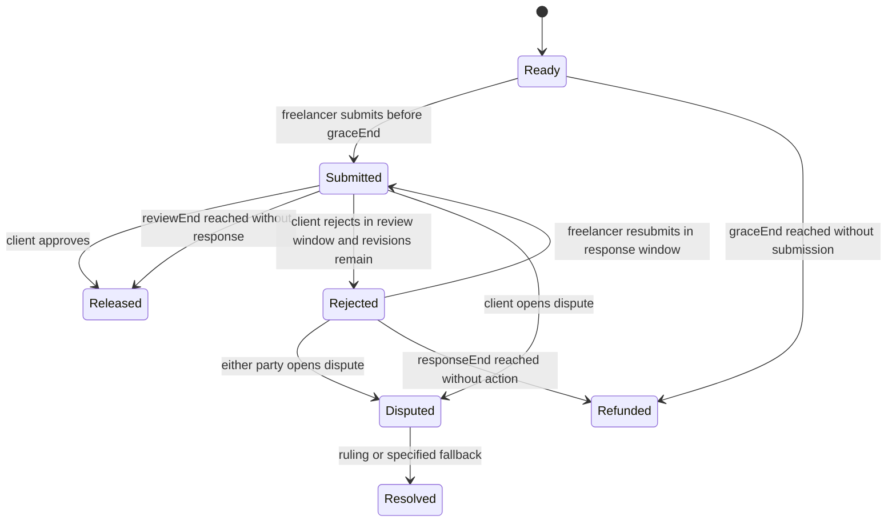

# Fairwork v3 — Product and Protocol Specification

**Status:** Draft specification derived from [`fairwork_v3_spec.md`](./fairwork_v3_spec.md). It describes intended behavior; it does not claim that a working application or contract already exists.

**Purpose:** Define the user-facing product, on-chain escrow rules, off-chain marketplace boundaries, security and privacy controls, and acceptance criteria for implementation. Requirement IDs from the source brief are retained for issue, commit, and test traceability.

## 1. Product summary

Fairwork is a marketplace for freelance and other gig work. A client and freelancer agree on scope, price, delivery timing, revision count, and one payment token. The agreement is represented on-chain, the client funds the full milestone amount into an escrow contract, and payments are released only by the contract's rules. If the parties disagree, a vetted arbiter panel rules on the disputed milestone.

Listings, chat, private descriptions, files, evidence content, and moderation are off-chain. The chain records wallet addresses, agreement commitments, lifecycle events, and token accounting. The contract is authoritative for payment state. The website must never claim a payment is approved, refunded, or released based only on a database record.

### 1.1 Product goals

- Protect both parties with a funded, auditable agreement before work starts.
- Support multiple approved ERC-20 tokens, including wBTC and stablecoins where deployed and explicitly whitelisted.
- Make deadlines, reviews, revisions, disputes, and refunds enforceable through a finite state machine.
- Give parties a clear audit trail without putting private work or personal data on a public chain.
- Keep moderation powers separate from escrow custody.
- Make the local-chain demo reproducible and testable.

### 1.2 Out of scope for the initial release

- Native Bitcoin settlement. “BTC” in this product means an approved token representation such as wBTC on the selected EVM chain; the contract does not accept native BTC.
- Fiat conversion, fiat on-ramps, or exchange-rate guarantees.
- A claim that code, hashes, or arbiters can objectively determine work quality.
- Mainnet deployment or a claim of professional audit/security certification.
- Upgradable escrow logic or an administrator withdrawal path.

## 2. Actors and trust boundaries

| Actor | Allowed responsibilities | Trust boundary |
| --- | --- | --- |
| Client | Propose/accept terms as applicable, fund, review, approve, reject within the revision limit, dispute, provide evidence, withdraw refunds | Cannot withdraw escrow except through a valid contract outcome |
| Freelancer | Accept terms, submit work commitments, resubmit within the agreed process, dispute, provide evidence, withdraw earned funds | Cannot alter price, deadline, or scope after acceptance without a mutual amendment |
| Arbiter | Review assigned case material, commit and reveal a ruling, receive protocol salary when that P1 system exists | Cannot be either party, cannot move escrow funds, and is subject to no-show penalties |
| Reviewer/moderator | Review evidence and on-chain outcomes; warn, suspend, or ban accounts | Off-chain access is audited; cannot change contract state or seize funds |
| Protocol operator | Deploy/configure the contract and administer the arbiter registry under published bounds | No function may transfer a user's escrow, claimable balance, or dispute deposit for the operator's benefit |
| Website/backend | Serve listings, private data, chat, and files; index chain events; enforce account and file access | May not be the authority for payment outcomes; all private routes authorize every request |
| Blockchain/token issuer | Provides execution and ERC-20 behavior | Assumed chain finality and whitelisted token behavior; issuer-level freezes, blacklists, depegs, or chain outages remain external risks |

Wallet addresses are public and pseudonymous, not anonymous. All user-supplied text, hashes, URIs, uploads, signatures, and database identifiers are untrusted input.

## 3. Core agreement and state model

### 3.1 Agreement contents

An accepted job binds:

- Client and freelancer addresses.
- One whitelisted ERC-20 token for the job.
- A bounded number of milestones, each with an integer amount and a commitment to its acceptance criteria.
- A scope commitment and description commitment.
- A delivery duration in seconds for each milestone. Milestones run in parallel and each delivery clock starts at funding.
- A review duration, a negotiated revision limit (0–5) applied independently to each milestone, and the relevant dispute rules.
- The acceptance time, funding deadline, and funded timestamp.

The locked interpretation is in §11 (D-01 and D-04). The UI must display each milestone's duration and its own revision counter before signing.

All values are integers. Token amounts are expressed in the token's smallest unit and stored without decimal conversion. One job uses one token; no currency conversion is performed by the contract. UI fiat estimates, if later shown, are informational and must identify their source and timestamp.

### 3.2 Job lifecycle

The direct path creates a proposed job for a named freelancer. It has no funded value until the freelancer accepts and the client funds it. A marketplace signed-offer acceptance creates the equivalent accepted, unfunded agreement in one transaction. The proposed-job expiry rule is the Phase 0 assumption A-01 in §12.

```mermaid
stateDiagram-v2
    [*] --> Proposed
    Proposed --> AcceptedUnfunded: freelancer accepts
    Proposed --> Cancelled: client cancels or proposal expires
    AcceptedUnfunded --> Funded: client deposits full milestone total
    AcceptedUnfunded --> Cancelled: funding window expires; anyone calls
    Funded --> Closed: every milestone is terminal
```

`Funded` is the active job state; there is no separate `Active` state. Milestones run in parallel. `Cancelled` before funding moves no user funds. Anyone may cancel after the proposal or funding window expires; neither path has a funded balance to distribute. A ban, listing removal, or moderation action never changes an accepted job's contract lifecycle. The job becomes `Closed` in the transaction that makes its last milestone terminal.

### 3.3 Milestone lifecycle

Each milestone has a bounded, one-way lifecycle. Its terminal state is `Released`, `Refunded`, or `Resolved`; settlement credits the appropriate parties' pull-payment balances. Withdrawal is a separate ledger action and does not change a terminal milestone's state.

The authorization, deposit, and dispute-window rules are locked in §11. A milestone in `Disputed` cannot be amended, rejected, approved, refunded, or settled through another path until dispute resolution settles it. `Released`, `Refunded`, and `Resolved` are terminal. Claimable and withdrawn amounts are payment-ledger statuses, not milestone states.

### 3.4 Time-window convention

To make exact-boundary behavior deterministic, every window uses half-open action bounds: an action is valid when `now < windowEnd`; the timeout action becomes valid when `now >= windowEnd`. Thus, at the exact end timestamp, a client may no longer approve/reject and the corresponding timeout path may be called. This convention is locked in §11 and must be tested one second before, exactly at, and one second after every deadline.

Submission is accepted when `now < graceEnd`, including during grace. At the exact grace-end timestamp, submission closes and anyone may trigger the client refund path.

## 4. Functional requirements

Priority meanings: **P0** must work for the local demo and has no completion credit without required automated coverage; **P1** follows once the core path is green; **P2** is optional/stretch. Unless otherwise stated, priority and IDs match the source brief.

### 4.1 Job creation, agreement, and funding

- **F-01 (P0):** Create a direct job with a named freelancer, supported token, title/description commitment, bounded milestones, amounts, delivery rule, acceptance-criteria commitments, and revision limit. Validate nonzero amount, nonzero distinct parties, allowed token, and maximum milestone/revision bounds (S-07, S-08).
- **F-02 (P0):** Require freelancer acceptance before funding. Show and confirm the freelancer address in the UI (S-18).
- **F-03 (P0):** Client funds the complete milestone total in one transaction. Confirm exact received balance delta; reject fee-on-transfer or otherwise unsupported token behavior. No work clock starts before funding.
- **F-04 (P1):** Permit client edit/cancel before acceptance and funding only. No funds move.
- **F-05 (P1):** Mutual cancellation through both parties' signatures; define the split and nonce/expiry rules before implementation. Disputed or already settled amounts are not included.
- **F-06 (P1):** Provide bounded lookup/indexing helpers for jobs and milestones; do not use unbounded contract loops for payout or ruling.
- **F-85 (P0):** Start a funding window after acceptance. If it expires unfunded, any account may cancel. Start delivery clock only at funding. The tracker must clearly show `Not funded`; freelancer should not start.
- **F-40/F-41 (P1):** Execute amendments only when both parties provide valid EIP-712 signatures. Supported changes are amount/deadline changes and adding/removing milestones that have not started. Reject amendments during disputes or after affected funds are paid. Record every executed amendment in the audit trail. Increases require an additional deposit; decreases refund the difference in the same transaction. Define signature nonce/expiry, amount conservation, and “started” before implementation.

### 4.2 Delivery, review, and revisions

- **F-10 (P0):** Freelancer submits a versioned deliverable hash and optional short opaque URI. The file is not stored on-chain.
- **F-11 (P0):** Client approval settles the milestone and credits the freelancer's claimable balance; it does not make an external token transfer in the approval call.
- **F-12 (P0):** Client rejection is permitted only during the review window and while rejection count is below the agreed revision limit. It includes a reason commitment that the freelancer can read through authorized off-chain storage.
- **F-13 (P0):** Each resubmission increments a version and appends to an immutable submission history. A rejection consumes one revision. Once the limit is reached, the client may approve or dispute but cannot reject again.
- **F-14 (P1):** Hash local files in the browser with SHA-256 and provide a verification page. Multi-file work is represented by a user-created archive. Hash algorithm, canonicalization, and content-manifest approach must be explicit in the UI.
- **F-15 (P2):** Optional IPFS upload; never treat an IPFS URI as private by default.
- **F-20 (P0):** Silence through the review window allows anyone to trigger auto-release to claimable balance. The client cannot later reject or dispute through the ordinary review path.
- **F-22/F-86 (P0):** Enforce the negotiated fixed revision limit on-chain. Limit zero means the client cannot reject; it may approve or use an allowed dispute path. Silence after any submission, including after the limit is exhausted, leads to auto-release.
- **F-87 (P1):** For configured categories, store preview and final separately. Commit the final-file hash with submission. The server releases final content only for the on-chain outcomes and configured threshold in §8; below 50% freelancer share, the client receives no final file. Signed URLs are short-lived and checked against current canonical chain state.

### 4.3 Deadlines and timeouts

- **F-21 (P0):** If no submission exists when the deadline plus grace expires, anyone may credit the milestone amount to the client's claimable balance.
- **F-23 (P1):** Extend deadlines only with both parties' valid EIP-712 signatures. A disputed or terminal milestone cannot be extended.
- **F-24 (P0):** Following a rejection, enforce the configured freelancer dispute/resubmission window. If it expires without the required action, client refund becomes available as specified by the chosen dispute policy.
- **S-21/S-23/S-24/S-26 (P0):** Gate every action by explicit timestamps and states. Submission/refund and approval/auto-release races must resolve by the first valid transaction under the chosen boundary convention.
- **S-30/S-31 (P1/P0):** Production windows must be long enough that small block timestamp variation is immaterial. Demo and production durations are deployment configuration, with production minimum bounds.

### 4.4 Disputes and arbitration

- **F-30 (P0):** Open one dispute for an eligible submitted/rejected milestone. Freeze that milestone's amount and take the opener's deposit once; the counterparty may match it before the evidence deadline. A second dispute or repeated deposit call must revert.
- **F-31 (P0):** Permit bounded evidence submissions during the evidence window. Store only hashes and short opaque references on-chain; private content is encrypted/off-chain and access-controlled.
- **F-32 (P0):** Select three distinct whitelisted arbiters using a VRF-backed selector; exclude client and freelancer. The arbiter pool is managed with off-chain identity review, while the chain stores only wallet eligibility/stake status.
- **F-33 (P0):** Provide commit and reveal phases with separate deadlines. A vote commitment binds chain ID, escrow address, dispute ID, arbiter address, basis-point vote, and salt. Reveal is accepted only from the assigned arbiter and only if it matches the commitment.
- **F-34 (P0):** Accept votes from 0 to 10,000 basis points for freelancer share. With three reveals use the median; with two reveals use the floored arithmetic mean. For a share `b`, freelancer amount is `floor(amount × b / 10000)` and the remainder goes to the client (S-06, S-44, S-45).
- **F-35 (P0):** Implement bounded no-show and no-quorum fallbacks described in S-40–S-42. After a second panel also fails quorum, default to 5,000 bps and refund deposits. No dispute path may leave funds permanently locked.
- **F-36/F-37 (P1):** Treasury handling, fixed arbiter salary, stake, slash, and cooldown withdrawal require explicit accounting and authorization. Deposits do not fund arbiter salary.
- **F-38 (P1 in the legacy catalog):** Tier C only and out of scope for this release. If later authorized, appeal timing, eligibility, and finality must be specified before implementation.
- **F-45 (P0):** Maintain an arbiter whitelist managed through a documented identity-vetting process. Private identity information stays off-chain.
- **F-46 (P1):** Provide arbiters a dashboard of assigned cases, deadlines, and commit/reveal actions. The contract remains authoritative for assignment and phase.
- **F-47 (P1):** Track arbiter vote distance from panel outcomes under a documented rule; flag repeated outliers for human review. Any stake slash or whitelist removal requires an explicit authority, evidence, event, and review path.
- **S-16/S-40–S-51:** No conflicts or duplicate panel members; no-show slashing and replacement are bounded; the second failed panel fallback is deterministic; commit/reveal prevents copying; deposits and evidence caps limit spam; an already settled milestone cannot be reopened.

### 4.5 Marketplace, offers, and moderation

- **F-80 (P1):** Publish freelancer-controlled listings for any category of gig work. Store title, category, skills, opening price/token, delivery days, included revisions (0–5), and voluntarily shared samples off-chain. Listings and samples are public by design.
- **F-81 (P1):** Browse listings and begin a private thread; search/filter is P2.
- **F-82 (P1):** Private text-only chat between the counterparties, with report/block controls. Do not auto-render links. Enforce authorization on every request.
- **F-83 (P1):** The buyer's first offer matches the listing's opening price. Either party may send an offer containing price, token, delivery term, revision limit, scope commitment, signer, named counterparty, nonce, and expiry. The recipient may accept, decline, or counter. The thread can be closed. Counters may be unlimited, subject to rate limits. Show only the latest offer as the live offer, while warning that earlier offers remain acceptable until their own expiry or cancellation.
- **F-84 (P1):** Offers use EIP-712 signatures. The named counterparty alone may submit acceptance. Successful acceptance creates the agreed on-chain job; the direct path remains available for demo/testing. The signer may cancel an offer on-chain. An older offer remains valid until its own expiry or explicit cancellation, even when a newer counter exists; the UI must warn about this source-defined behavior.
- **F-88 (P1):** Generate moderation signals only from on-chain outcomes: a client signal when a dispute gives the freelancer at least 80%; a freelancer signal when the client gets at least 80% or after a missed-deadline auto-refund. A complaint alone is not a signal. Count each eligible outcome once.
- **F-89 (P1):** Queue wallets after two signals in the configured 90-day lookback, or one evidence-backed flag. A human reviewer can dismiss, warn, suspend for 30 days, or permanently ban; record and expose the reason to the affected user. Apply consistently to clients and freelancers.
- **F-90 (P1):** A ban blocks sign-in/listings/new offers on the site. Existing jobs continue under contract rules and funds are untouched.
- **F-91 (P2):** Optional on-chain blocklist prevents new job creation/offer acceptance only; it cannot change existing jobs or balances.
- **F-92 (P2):** One appeal per ban, decided by a different reviewer.
- **F-93 (P2):** Optional purchase of extra revisions through mutual signed amendment and additional payment, subject to the amendment accounting rule.

### 4.6 Tracking, frontend, and demo

- **F-50 (P0):** Show per-job and per-milestone states: unfunded, locked, submitted/pending review, disputed, claimable, withdrawn/released, and refunded. Explain that `claimable` is not yet an external token transfer.
- **F-51 (P0):** Build a chronological event feed from contract events and append-only off-chain audit events for actions that are not on-chain. Label the source of each event.
- **F-52 (P1):** Export audit data as JSON/CSV.
- **F-53 (P1):** Show role-aware action-needed banners and countdowns.
- **F-54 (P2):** Show completed-job and dispute-outcome counts on freelancer listings. Define the calculation and privacy implications; do not imply that an outcome count objectively measures work quality.
- **F-60 (P0):** Provide create-job and job detail/timeline screens. Show only role/state-valid actions; the contract remains the enforcement layer.
- **F-61 (P0):** Connect wallet, verify chain ID and configured contract address, and block actions on unsupported networks.
- **F-62 (P0):** Provide local-demo role switching only in dev builds.
- **F-63 (P0):** Show pending, confirmed, and failed transactions with readable custom-error messages.
- **F-64 (P1):** Show review, delivery, funding, and dispute countdowns sourced from chain timestamps.
- **F-70/F-71 (P0):** One-command local seed/reset and dev-only time warp. These endpoints and controls are absent from public builds.
- **F-72 (P0):** README includes architecture, threat notes, and limitations.
- **F-73 (P0):** Publish actual test and coverage results; do not report unrun tests as passing.
- **F-74 (P0):** Record a backup demo video by the source brief's hour-16 deadline.
- **F-75 (P1):** Optional public testnet deployment; no mainnet deployment in this scope.

## 5. Token, payout, and accounting rules

1. A job uses one explicitly whitelisted ERC-20 token. wBTC and stablecoin support depends on the selected chain and deployed token addresses; no symbol alone is sufficient for trust.
2. Store and calculate raw token units. Read token decimals only for display and validation; never use floating point in contracts or backend accounting.
3. At deposit, measure `balanceAfter - balanceBefore` and require it to equal the requested amount. Use SafeERC20-style calls. Reject fee-on-transfer, rebasing, callback, or otherwise unsupported tokens unless separately reviewed and explicitly supported.
4. Track liabilities per token: escrow-locked milestone balances, user claimable balances, deposits, and arbiter stakes. The actual token balance must be **at least** the internal liability total. Direct/forced token transfers create unassigned excess and must not alter user balances. This reconciles S-04's accounting goal with X-08's forced-transfer case.
5. No administrator function can withdraw or reassign liabilities. Payouts are pull-based. Withdrawal zeroes the caller's claimable amount before the external token call and is protected against reentrancy.
6. For split amount `A` and freelancer basis points `b`, compute `F = floor(A × b / 10,000)` and `C = A - F`; no remainder is stranded.
7. An approval, timeout, or ruling credits ledger balances atomically and makes the milestone terminal. A second settlement call reverts. A failed recipient transfer cannot block settlement because transfer is deferred to withdrawal.
8. Stablecoins may depeg, freeze, blacklist, or change issuer behavior. wBTC may diverge from native BTC. These are token/issuer risks, not price guarantees made by Fairwork.

## 6. Off-chain data, privacy, and website controls

### 6.1 Data placement and access

| Data | Storage/access rule |
| --- | --- |
| Wallets and payment events | Public chain; warn that addresses are pseudonymous and histories are permanent |
| Private job description, criteria, rejection reasons | Off-chain encrypted database; client/freelancer, and assigned panel only when needed |
| Deliverables/evidence | Private file storage; authorized counterparties and assigned panel during case; panel access ends after final ruling/appeal window |
| Listings and voluntary samples | Public off-chain content |
| Chat/offers | Off-chain, encrypted at rest, counterparties only; reviewer access only for an evidence-backed queued case and logged |
| Login/session records | Wallet-signature login; no password database; short-lived server-side session |
| Review/ban records | Off-chain, visible to affected user and authorized reviewers |
| Logs | Security metadata only; no secrets, tokens, private text, or file contents |

Private text commitments use a random salt. The salt and plaintext remain private unless a party intentionally discloses them to an assigned arbiter. Never put names, email, phone, private text, file content, private-text salts, or private signed URLs on-chain. Arbiter vote salts are distinct random values intentionally revealed publicly in commit/reveal calldata and must never be reused for private content (A-13). Sequential job IDs are not an authorization mechanism.

### 6.2 Privacy requirements

- **P-01 (P0):** No personal information on-chain.
- **P-02 (P0):** Do not require real name, phone, or email; an optional display name is counterparty-only.
- **P-03 (P0):** Salt commitments to short/guessable private text.
- **P-04 (P0):** Authorize each private read/write for client, freelancer, or assigned arbiter as appropriate.
- **P-05 (P0):** Arbiter access is limited to the assigned case and revoked after final resolution, including the configured appeal period.
- **P-06 (P1 for client-side encryption):** Prefer client-side AES-GCM encryption before upload and define key exchange/recovery before claiming end-to-end encryption. The server-side AES-256-GCM-at-rest baseline in D-11 is mandatory Tier A/P0; never claim it is end-to-end encryption.
- **P-07 (P0):** Do not expose private jobs through enumeration endpoints; authorization must not depend on hidden IDs.
- **P-08 (P1; D-11 retention subset is Tier A/P0):** Publish retention periods and support deletion of eligible off-chain data 90 days after closure or on request using a script. Explain that on-chain data cannot be deleted.
- **P-09 (P1):** Publish a plain-language privacy notice.
- **P-10 (P1; D-11 access-log subset is Tier A/P0):** Apply the same authorization/retention rules to chat and offer history. Log reviewer and arbiter access as required by D-11; broader chat/offer retention remains P1.

### 6.3 Web controls

- **W-01–W-04 (P0):** Use SIWE/EIP-4361 with expiring single-use server nonce, server-side signature verification, secure short-lived `HttpOnly`, `Secure`, `SameSite` cookies, server invalidation on logout, per-route authorization, and rate limits.
- **W-05–W-08 (P0):** Use parameterized queries/ORM, server-side schema validation, plain-text rendering, safe markdown sanitization, CSP, and origin/CSRF protection for writes.
- **W-09 (P1):** Never fetch user-supplied URLs server-side.
- **W-10–W-11 (P0):** Use random filenames, content-based file checks, size limits, storage outside public web root, safe attachment serving, authorization, and short-lived signed download URLs. Do not serve HTML/SVG uploads as active content.
- **W-12–W-14 (P0):** HTTPS/HSTS for public deployment; CSP/frame-ancestors, `nosniff`, restrictive referrer/permissions policies; same-origin CORS allowlist.
- **W-15–W-20:** Keep secrets server-side and out of history/bundles; least-privilege database access, encrypted backups, pinned lockfile/dependency review, protected reviewer routes, generic user errors, and privacy-safe logs.
- **W-21–W-23:** Bound payloads, paginate, rate-limit, disable dev tools/seed endpoints in public builds, and bind local demo services to localhost.
- **W-24–W-25 (P0):** Show pinned domain/contract and human-readable transaction/signature summaries; request exact token allowance, never unlimited allowance.

## 7. Security model and failsafes

The contract should be non-upgradeable for the initial release, use a pinned Solidity 0.8+ compiler and reviewed library versions, and avoid unaudited copied code. Use constructor/configuration validation, role checks, custom errors, checks-effects-interactions, reentrancy protection, bounded loops, exact state guards, and pull payments.

| Requirement group | Required behavior |
| --- | --- |
| **S-01–S-11 (P0)** | Reentrancy protection; pull payouts; timeout exit for every nonterminal state; per-token ledger solvency; strict token allowlist and exact balance deltas; deterministic split rounding; input validation; bounded milestone count/checked arithmetic; terminal one-way settlement; no admin access to user liabilities; no unbounded settlement loops |
| **S-15–S-18** | Role-gate every action; exclude parties/duplicates from panels; permissionless timeout pokes may only pay the rightful party; freelancer must accept and UI confirms address |
| **S-20–S-26 (P0)** | One transition table; all time boundaries tested; first valid terminal action wins; no late submit/refund race; reject only during review; hard revision limit; bounded post-rejection exit |
| **S-30–S-32** | Production-safe time windows; short local-only demo values; mutual signature for extensions |
| **S-40–S-51** | Commit/reveal deadlines, bounded replacement/redraw/default, address-bound salted commitments, 0–10,000 vote bounds, 2-vote mean/3-vote median, deposits and evidence caps, no settled-milestone disputes, coherence review only under explicit rules |
| **S-55–S-57** | If amendments are built: EIP-712 chain/contract domain, nonce and expiry; prohibit during dispute/after payment; define top-up/refund atomically |
| **S-60–S-66** | Enforce network, disable duplicate submit, map errors, refetch from chain, role/state-gate UI, confirm destructive actions, keep dev-only tools out of public builds |
| **S-70–S-73** | Local chain is primary demo; reset is reproducible; backup video exists; demo accounts and roles are documented |
| **S-80–S-85** | Keep this spec canonical; inspect test diffs; pin and compile dependencies; human-review money paths; protect secrets; obtain an independent adversarial review before submission |
| **S-90–S-107** | Signed terms bind actual job values; old/expired/cancelled/replayed/wrong-caller offers fail as specified; rate-limit offers; bound prices; freeze accepted terms; expire unfunded jobs; start delivery at funding; gate final files; derive signals from outcomes; prevent report-only bans; preserve open jobs after bans; document sybil limits; render chat safely; fuzz token-decimal/rounding math |
| **X-01–X-14** | Test reentrancy, access control, MEV, VRF selection, denial-of-service, signature replay, odd tokens, forced transfers, arbiter sybil/bribery assumptions, salary farming, dependency risk, on-chain privacy, offer integrity, and final-file leakage |
| **X-20–X-28** | Plain-text/XSS defense, safe evidence links, readable signing, no browser secrets, pinned chain/contract, chain as payment authority, dependency hygiene, browser policy, local file hashing |

Admin/arbiter registry actions must be constrained to published parameters and arbiter eligibility. Any stake slash must have an explicit trigger, evidence, event, and review path; it may affect only the arbiter's own posted stake. No moderation action changes user escrow.

## 8. Deployment parameters

The following starting values and rules are locked in §11. Production values remain proposals for a later deployment review. Store time values in seconds and monetary values in raw token units.

| Parameter | Production proposal | Demo/local | Notes |
| --- | --- | --- | --- |
| Proposal window | Same duration as funding window | 1 minute | A-01; starts at direct job creation; acceptance requires `now < proposalEnd` |
| Funding window | 2 days | 1 minute | Starts at freelancer acceptance |
| Review window | 7 days | 2 minutes | Starts on each accepted submission |
| Grace period | 3 days | 1 minute | `graceEnd = deadline + gracePeriod` |
| Freelancer response window | 3 days | 1 minute | Starts on rejection; supports resubmit or dispute |
| Evidence window | 3 days | 1 minute | A-04 anchors it at dispute opening |
| Commit / replacement commit / reveal | 2 days / 1 day / 2 days | 1 minute each | Commit and reveal apply separately to each panel |
| Randomness timeout | 1 day | 1 minute | Initial request plus at most 2 retries per draw |
| Offer expiry (Tier B) | 48 hours | 2 minutes | Every offer has its own expiry |
| Revision limit | 0–5 | 0–5 | Independent counter per milestone |
| Maximum milestones per job | 10 | 10 | Bounded loops |
| Per-milestone amount | Deployment-configured per token | 1–10^18 raw units | Demo job total at most 10×10^18 raw units; checked addition |
| Duration bounds | 1 hour–365 days | 1 second–365 days | A-12; checked deadline addition |
| Panel size / quorum | 3 / 2 | 3 / 2 | Eligible panel excludes both parties and duplicates |
| Arbiter pool | At least 5 allowlisted and 3 eligible after party exclusion before production funding | Seed 6 | Panel 2 requires a fresh panel; A-02 defines bounded behavior when the pool is exhausted |
| Arbiter registry cap | 128 | 128 | A-10 bounds registry/pool loops |
| Dispute deposit | 2% of disputed milestone amount, min 1 raw unit | 2% | Opener posts; counterparty may match; A-08 requires `depositBps` 1–10,000 |
| Evidence entries | 5 per party | 5 per party | Hash and short opaque reference only |
| Final-file threshold (Tier B) | 50% | 50% | At or above threshold client access; below it no final file |
| Price limits | Deploy-configured min/max | Demo-configured | Token-specific raw units |
| Supported tokens | MockUSDC (6 decimals), MockWBTC (8 decimals) | Plus 18-decimal test-only mock | Address, symbol, decimals from deployment output |
| Opaque reference | `bytes32` | `bytes32` | A-13; not an arbitrary URL |

Production deployments enforce a minimum one-hour duration for every window. The demo configuration skips that check and is blocked from public builds. Demo time-warp, seed endpoints, and mock randomness must be excluded from public builds.

## 9. Requirement traceability and acceptance

The detailed feature catalog is in §4. IDs remain the stable references for implementation tasks and tests:

- Jobs: **F-01–F-06**, **F-84–F-86**
- Delivery/timeouts: **F-10–F-15**, **F-20–F-24**
- Disputes/registry: **F-30–F-38**, **F-45–F-47**
- Tracking/frontend/demo: **F-50–F-75**
- Marketplace/moderation: **F-80–F-93**
- Contract safeguards: **S-01–S-107** (listed groups in §7)
- Privacy: **P-01–P-10** (§6.2)
- Website security: **W-01–W-25** (§6.3)
- Threat model: **X-01–X-28** (§7)

### 9.1 Required acceptance scenarios

At minimum, tests must cover:

1. Direct create → accept → fund → submit → approve → withdraw.
2. Signed offer → correct counterparty acceptance → fund; reject expired, cancelled, replayed, and third-party acceptance.
3. No funding, funding at the boundary, and permissionless cancellation after the funding window.
4. Delivery clock begins at funding; no submission by deadline+grace credits refund; a submission during grace is accepted; one at/after grace end is rejected.
5. Review-window approve/reject and auto-release at one second before, exactly at, and one second after end.
6. Revision limits 0, 1, and maximum; each rejection consumes one; exhausted limit blocks reject; resubmission history and silent auto-release still work.
7. Rejection dispute window and client refund fallback.
8. Dispute deposits taken at most once, evidence cap, party exclusion, duplicate arbiter exclusion, commit/reveal validation, 2-vote average, 3-vote median, no-show replacement, second panel, and final 50/50 fallback.
9. Odd amounts and arbitrary basis points conserve every token unit; split never strands rounding dust.
10. Pull withdrawal with reverting/reentrant recipient; repeated withdrawal/settlement; fee-on-transfer token rejection; direct/forced token surplus; solvency invariant by token.
11. Off-chain authorization: user C cannot read/write A/B job, chat, evidence, review data, or final file; final file follows chain threshold.
12. Ban does not affect an open job or funds; banned account cannot create new website offers/listings.

### 9.2 Definition of done

- Every P0 feature works end-to-end on the local chain from the UI.
- Every applicable P0 failsafe has at least one automated test.
- All state transitions have positive and illegal-transition coverage; all time windows have boundary tests.
- Fuzz/invariant checks cover solvency, no double payout, no stuck funds, and rounding conservation.
- Slither findings are fixed or documented; contract payout, timeout, and ruling paths receive human review.
- Attack Lab scenarios run; no secrets exist in the repository or client bundle; dev features are absent from public builds.
- Demo reset and script are repeatable; demo is rehearsed twice and backup video is recorded.
- README lists implemented scope, omitted features, actual test commands/results, limitations, and deployment status.
- If marketplace P1 work is included, listing → negotiation → accepted signed terms → funded job → delivery → release works end to end.
## 10. Superseded open decisions

The 13 open decisions in the source draft are resolved by D-01 through D-13 in §11. Those decisions close the corresponding items formerly listed here. Additional explicit Phase 0 assumptions are in §12 and `DECISIONS.md`. Remaining documentation and integration gaps are catalogued in `docs/GAPS.md`; the most significant production randomness constraint is in `docs/RANDOMNESS_PLAN.md`.

Scope precedence follows HERO_PROMPT.md §6: F-38 is Tier C despite its legacy P1 catalog label. F-74 is a human-recorded backup video deliverable; the team must record it and cannot claim the agent produced it. D-11's server-side encryption, 90-day retention/deletion script, and reviewer/arbiter access logging are Tier A/P0 application requirements for Phase 4 implementation even though the related P-06/P-08/P-10 labels include P1 work. Phase 0 records these decisions but does not implement the backend. The phase order in HERO_PROMPT.md §8 controls; the conflicting phase numbering in `implementation.md` is marked in that file.

## 11. Locked decisions

Record all of these in `DECISIONS.md` and in a new section of `spec.md` before coding.

**D-01 Milestone scheduling (spec 10.1).** Milestones are **parallel and independent**. Each milestone stores a **duration in seconds** chosen at creation. At funding: `deadline = fundedAt + duration`, `graceEnd = deadline + gracePeriod`. No predecessor dependencies. Durations need not be ordered. Delivery clocks start only at funding.

**D-02 Dispute initiation and deposits (10.2).**
- The client may open a dispute from `Submitted` while `now < reviewEnd`. Either party may open from `Rejected` while `now < responseEnd`.
- The opener posts a deposit `D = max(1, amount * depositBps / 10000)` raw units in the job token when opening. The counterparty **may** match `D` before `evidenceDeadline`.
- Forfeiture after the ruling: freelancer share above 5000 bps means the client forfeits `D`. Below 5000 means the freelancer forfeits `D`. Exactly 5000 means each forfeits `floor(D/2)`. The other portions are refunded.
- If the forfeiting party never posted a deposit, the forfeited amount is deducted from that party's ruling payout, capped at the payout.
- Forfeited amounts are credited to the configured `treasury` address's claimable balance. Deposits never fund arbiter pay.
- No-quorum fallback (50/50): every posted deposit is refunded in full and nothing is forfeited.
- One dispute per milestone. A second open or a repeated deposit reverts.

**D-03 Rejection and dispute interaction (10.3).** After a rejection the freelancer has `responseWindow`. During it they may resubmit or open a dispute, and the client may also open a dispute. Opening a dispute moves the milestone to `Disputed` and stops the refund timer. If `now >= responseEnd` with no action, anyone may trigger the client refund.

**D-04 Revision scope (10.4).** The negotiated `revisionLimit` (0 to 5) applies **independently per milestone**. Each milestone stores its own `rejectionCount`. The client may reject at most `revisionLimit` times per milestone. Limit 0 means the client can never reject. Once exhausted, the client may only approve, dispute, or stay silent (silence leads to auto-release). The UI must show the same per-milestone rule before signing. Never implement a shared counter.

**D-05 Offer concurrency (10.5, Tier B).** Keep the source behaviour: an older offer stays acceptable until its own expiry or explicit cancellation, even after a newer counter. Accepting an offer marks only that offer used. The thread closes in the application and the UI warns about older offers.

**D-06 Tokens (10.6).** Local chain (Anvil, chain ID 31337). Allowlist at deployment: `MockUSDC` (6 decimals) and `MockWBTC` (8 decimals), plus a 18-decimals mock used only in tests. One token per job and all milestones use it. Per-token min and max amounts in raw units are deploy-configured. No rebasing, callback or fee-on-transfer tokens. Token address, symbol and decimals come from deployment output, never from a symbol alone.

**D-07 Display conversion (10.7).** No USD or BTC conversion is shown. No oracle.

**D-08 Randomness and no-show (10.8).**
- An `IRandomness` adapter interface. Production plan: a verifiable randomness provider whose exact current integration you must take from its official documentation (do not recall it from memory). Local: `MockRandomness`, labelled DEMO ONLY in code, docs and UI, excluded from public builds by a build check.
- Panel request happens after `evidenceDeadline`. If randomness is not delivered within `randomnessTimeout`, anyone may retry, at most 2 retries, then the 50/50 fallback applies.
- Minimum eligible pool after excluding the parties: 3. Require at least 5 allowlisted arbiters before a job can be funded in a production config. The demo seeds 6.
- Sequence: Panel 1 commit window. At commit deadline, arbiters who did not commit are replaced **once** (each vacancy), with its own `replacementCommitWindow`. Reveal window follows. At the reveal deadline: 3 reveals means median, 2 means floored mean. With fewer than 2 reveals, draw one **entirely fresh** Panel 2 (excluding Panel 1 members) and repeat commit and reveal with no further replacement. If Panel 2 also has fewer than 2 reveals, rule 5000 bps and refund deposits.
- Stake slashing is Tier B. In P0, `arbiterStake = 0`. If stakes exist later, no-show stakes remain slashable in the fallback.

**D-09 Arbiter registry (10.9).** The owner adds and removes allowlisted arbiters after off-chain identity vetting. No private identity data on-chain. Stake, salary, slashing and the dispute-value-to-stake cap are Tier B and disabled in P0. The owner cannot touch any liability.

**D-10 Final-file access (10.10, Tier B).** If F-87 is built: the client gets the final file only when the milestone is Released (approved or auto-release) or Resolved with freelancer share at or above the 50% threshold. Below the threshold the client gets no final file. There is no partial release.

**D-11 Privacy and keys (10.11).** P0 baseline: server-side AES-256-GCM at rest with a master key from the environment. Do **not** claim end-to-end encryption. Retention: delete eligible off-chain private data 90 days after a job closes or on request (provide a script). Reviewer and arbiter access is logged. Arbiters are authorised by chain state, not by key sharing.

**D-12 Moderation (10.12, Tier B).** Signals only from on-chain outcomes (80% rulings, missed-deadline refunds). An evidence-backed flag means a report linked to at least one on-chain job outcome. Suspension blocks sign-in, listings and new offers, and still allows the user to read data for their open jobs. Appeals are Tier C.

**D-13 Deployment authority (10.13).** Local deployer EOA is the owner. Treasury address is fixed at deployment. The owner's only powers: add or remove arbiters (and Tier B arbiter parameters within published bounds). Production notes state that the owner would be a multisig behind a timelock. No role touches escrow liabilities.

**Time convention (locked, spec 3.4).** For every window with end `E`: the actor action is valid when `now < E` and the timeout action is valid when `now >= E`. Specifically:

| Window | End `E` | Action valid when | Timeout valid when |
|---|---|---|---|
| Funding | `acceptedAt + fundingWindow` | `now < E` fund | `now >= E` anyone cancels unfunded job |
| Submission | `graceEnd` | `now < E` submit (including during grace) | `now >= E` anyone credits client refund |
| Review | `reviewEnd = submittedAt + reviewWindow` | `now < E` approve, reject, or client dispute | `now >= E` anyone releases to freelancer |
| Response | `responseEnd = rejectedAt + responseWindow` | `now < E` resubmit or dispute | `now >= E` anyone credits client refund |
| Evidence | `evidenceDeadline` | `now < E` evidence | `now >= E` panel request allowed |
| Commit, replacement commit, reveal | each phase deadline | `now < E` commit or reveal | `now >= E` anyone advances |

**Milestone transitions (locked).**

| From | Action | Caller | Guard | To |
|---|---|---|---|---|
| Ready | submit | freelancer | `now < graceEnd`, hash non-zero | Submitted |
| Ready | refund | anyone | `now >= graceEnd` | Refunded (credit client) |
| Submitted | approve | client | `now < reviewEnd` | Released (credit freelancer) |
| Submitted | reject | client | `now < reviewEnd`, `rejectionCount < revisionLimit`, reason commitment non-zero | Rejected |
| Submitted | release | anyone | `now >= reviewEnd` | Released (credit freelancer) |
| Submitted | openDispute | client | `now < reviewEnd` | Disputed |
| Rejected | resubmit | freelancer | `now < responseEnd` | Submitted (version +1, new `reviewEnd`) |
| Rejected | openDispute | client or freelancer | `now < responseEnd` | Disputed |
| Rejected | refund | anyone | `now >= responseEnd` | Refunded (credit client) |
| Disputed | finalize | anyone | per D-08 | Resolved (split credited) |

Job states: Proposed, AcceptedUnfunded, Funded (active), Cancelled, Closed (all milestones terminal). `Cancelled` before funding moves no funds. Submission history per milestone is stored as a bounded array (at most `revisionLimit + 1` entries of hash, reference and time) and also emitted as events.

**Parameters** (seconds; raw token units for money). Production values are proposals, not final.

| Parameter | Production | Demo |
|---|---|---|
| Review window | 7 days | 2 minutes |
| Grace period | 3 days | 1 minute |
| Response window | 3 days | 1 minute |
| Funding window | 2 days | 1 minute |
| Offer expiry (Tier B) | 48 hours | 2 minutes |
| Evidence window | 3 days | 1 minute |
| Commit, replacement commit, reveal windows | 2, 1, 2 days | 1 minute each |
| Randomness timeout | 1 day | 1 minute |
| Revision limit | 0 to 5 | 0 to 5 |
| Max milestones per job | 10 | 10 |
| Panel size and quorum | 3 and 2 | 3 and 2 |
| Dispute deposit | 2% (min 1 raw unit) | 2% |
| Evidence entries per party | 5 | 5 |
| Final-file threshold (Tier B) | 50% | 50% |

Production deployments enforce minimum bounds (every window at least 1 hour). The demo configuration skips that check and is blocked from public builds.
## 12. Phase 0 assumptions

A-51 additionally requires a terminal PDF %%EOF marker after a separately frozen malformed-prefix reproduction; complete PDF object/xref and image decoding remain unimplemented and unverified.

Phase 5 application corrections are recorded before code changes: A-50 permits a named party to recover encrypted text/salts for a matching already-mined EvidenceCommitted entry after the evidence window or settlement, requiring the original event's canonical submittedAt < evidenceDeadline and exact dispute/party/hash/reference identity. New contract commitments and file drafts retain their half-open deadlines; settled arbiter access stays revoked. A-51 conservatively restricts PDFs to an inspectable passive subset, rejecting active action/form/embedded-content names (including PDF hex-name escapes), encrypted PDFs and compressed object streams. This is not a full parser or malware-safety claim; otherwise valid unsupported PDFs may be rejected. A-52 clears loaded private content, unsaved proposal/inline drafts and open confirmations at wallet/session boundaries and session expiry; late private reads cannot repopulate them. A-53 revalidates account/job/network and fresh action policy after confirmation and before sending, including wallet matching for sign-in completion. Requirement IDs and financial state transitions are preserved.

These are explicit Phase 0 assumptions. They do not change any requirement ID and close the named local-P0 gaps unless the spec is revised. Production-only items remain blocked where stated.

**A-01 Proposed-job expiry (assumption).** A direct job in `Proposed` has `proposalEnd = createdAt + fundingWindow`; the named freelancer may accept only when `now < proposalEnd`, and anyone may cancel it when `now >= proposalEnd` without moving funds. The client may cancel it earlier. This reuses the configured funding-window duration and adds no new duration parameter. The source documents specify client cancellation but do not define an expiry, despite requiring a bounded exit for every nonterminal state. This is a Phase 0 assumption to make that invariant complete.

**A-02 Randomness pool exhaustion (assumption).** If Panel 1 cannot be drawn, the dispute takes the deterministic 5000-bps fallback and refunds every posted deposit. At the Panel 1 commit deadline, make one replacement draw for all missing-commit vacancies. If the eligible pool cannot fill every vacancy, assign the distinct eligible arbiters available, leave the remaining slots vacant, and continue with the existing quorum rules. Panel 2 must contain three distinct arbiters not previously assigned to Panel 1, including its replacements. If a full fresh Panel 2 cannot be drawn, the dispute takes the deterministic 5000-bps fallback and refunds every posted deposit. Every such path emits a fallback reason identifying pool exhaustion and makes no unbounded draw attempt.

**A-03 Replacement timing (assumption).** At the Panel 1 commit deadline, make one bounded randomness draw for all missing-commit vacancies. After its callback, assign the distinct replacements returned and start one shared `replacementCommitWindow` for all of them. Reveal starts when that window ends. There is no second replacement attempt. If the draw returns fewer arbiters than there are vacancies, assign the available replacements and leave remaining slots empty; A-02 governs that case.

**A-04 Evidence clock (assumption).** `evidenceDeadline = disputeOpenedAt + evidenceWindow`; opening starts the evidence interval, and matching a deposit does not restart it. This keeps the interval bounded and anchored to one on-chain timestamp. The supplied decisions give the window duration but not its start or whether matching changes it.

**A-05 Phase 0 production randomness status.** The local `MockRandomness` adapter is DEMO ONLY. A production provider integration and the D-08 retry policy are not yet jointly resolved: current Chainlink VRF v2.5 security guidance prohibits re-requesting/cancelling randomness. The repository must not claim a production VRF implementation until a provider-safe retry/fallback design is documented and validated; see `docs/RANDOMNESS_PLAN.md`.

**A-06 Arbiter removal during a dispute (assumption).** Removing an arbiter from the allowlist prevents future panel assignments but does not revoke an arbiter already assigned to an open dispute. The assigned panel is snapshotted for that dispute and can complete its bounded commit/reveal flow. This prevents registry administration from stranding or silently changing an active case.

**A-07 Evidence submitters (assumption).** Only the client and freelancer submit dispute evidence; the five-entry cap applies independently to each party. Arbiters read authorized case evidence and submit votes through commit/reveal, not through the party evidence endpoint. The supplied rules do not define arbiter-authored evidence or its cap.

**A-08 Deposit configuration bounds (assumption).** `depositBps` is deployment-configured in the inclusive range 1–10,000. `D` uses integer floor division before applying the minimum of one raw token unit. A zero rate is invalid because the specified minimum would otherwise still charge one raw unit while the configured rate says zero.

**A-09 Randomness retry scope (assumption).** The D-08 limit means one initial randomness request plus at most two retries for each draw. It applies separately to the initial Panel 1 draw, the single aggregate replacement draw, and the fresh Panel 2 draw. Every attempt has a distinct provider request ID; a callback is valid only for the active ID while `now < requestEnd`. Expired, stale, and duplicate callbacks are ignored. If a request reaches `now >= requestEnd`, anyone may retry if fewer than two retries have been used; after the third request times out, apply the 5000-bps fallback and refund all posted deposits as D-08 requires. If the replacement draw responds but cannot fill all vacancies, A-02 applies.

**A-10 Bounded arbiter registry (assumption).** The allowlisted arbiter registry is capped at 128 addresses, so panel selection and eligibility checks remain bounded.

**A-11 Local token amount bounds (assumption).** For each demo token, a milestone amount is at least 1 and at most `10^18` raw units; a job total is at most `10 × 10^18` raw units, checked with overflow-safe addition. Production per-token min/max remain deployment-configured under D-06 and are not enabled by this local-only Phase 0 scaffold.

**A-12 Local duration bounds (assumption).** Demo duration inputs are between 1 second and 365 days. Production duration inputs are at least 1 hour and at most 365 days. All arithmetic that derives deadlines uses checked addition.

**A-13 Opaque references and commitments (assumption).** On-chain opaque references are fixed `bytes32` values, not arbitrary URLs. Text/evidence commitments use domain-tagged Keccak-256 over typed ABI-encoded values and a fresh random 32-byte salt kept off-chain. The vote reveal salt is a separate protocol value that the arbiter intentionally discloses in reveal calldata; it is never a private-text salt. This is an explicit public vote-only exception to the private-content salt rule.

**A-14 Phase 0 version pins.** The scaffold pins Solidity/solc 0.8.36, OpenZeppelin Contracts 5.6.1, Next.js 16.4.0, React 19.3.0, TypeScript 7.0.2, wagmi 3.7.7, viem 2.57.4, SIWE 3.0.0, zod 4.6.5, Tailwind CSS 4.3.3, and Prisma plus `@prisma/client` 6.12.0. The manifests and lockfile are authoritative for the installed dependency graph; version pins alone do not claim a successful build.

**A-15 Phase 0 application boundary.** Use one Next.js application in `apps/web`, with route handlers for API behavior when that work begins. Use Prisma with SQLite for local relational storage. The API/business behavior remains deferred until the relevant later phase; this is a scaffold/layout decision, not permission to implement it in Phase 0.

**A-16 Compiler-tooling dependency override.** Keep Solidity/solc pinned at 0.8.36 and scope the npm override to solc's transitive `tmp` dependency at 0.2.7, the patched version verified against registry/API metadata. This is compiler-tooling maintenance and does not change protocol behavior. The earlier audit reported vulnerable tmp versions. The final regenerated lockfile was audited successfully with zero vulnerabilities; exact command evidence is in docs/phase0-tooling.txt.

## 13. Phase 1 foundation decisions (recorded before behavior implementation)

**A-17 Phase 1 local boundary.** The foundation constructor permits chain ID 31337 only. There is no production configuration in Phase 1; production arbiter-eligibility checks and the registry belong to Phase 3. Supported mutations are createJob, acceptJob, fundJob, cancelExpiredProposal, cancelUnfundedJob and withdraw. Early client cancellation/editing (F-04) remains Tier B. Funded milestones stay Ready with locked principal; delivery/refund/release/dispute exits are not implemented until their later phases. This partial build must not hold real funds or be represented as a complete escrow.

**A-18 Foundation token configuration.** Constructor configuration is immutable and has one to three distinct deployed token addresses. Every entry supplies decimals (6, 8 or 18), minAmount>=1 and maxAmount<=10^18 raw units, with minAmount<=maxAmount. An optional expected runtime codehash must match; a zero value captures the current codehash. Runtime funding and withdrawal must confirm the pinned codehash. The production/demo allowlist is curated, not determined by a symbol or claimed standard: metadata, bytecode hashing and exact receipt checks cannot prove the absence of future rebasing, mutable proxy behavior or arbitrary callbacks. Only vetted fixed mock tokens belong in the local demo. Hostile tokens are isolated test fixtures used to demonstrate rejection/rollback and reentrancy safety, not tokens authorized for the demo.

**A-19 Foundation agreement surface.** createJob accepts one typed JobInput and 1–10 MilestoneInput entries. JobInput binds the named freelancer, token, nonzero title/description/scope/delivery-rule commitments, agreed reviewWindow and revisionLimit 0–5; client is msg.sender. Each milestone binds raw amount, delivery duration and nonzero acceptance-criteria commitment. The review duration is a per-job agreed value within immutable deployment min/max review bounds; demo uses 120 seconds. ProtocolConfig binds fundingWindow, gracePeriod, min/maxDuration and min/maxReviewWindow; all bounds/windows are positive and at most 365 days, with each minimum<=maximum. The existing funding/proposal boundary rule and parallel clocks remain unchanged. Every deadline addition uses checked arithmetic.

**A-20 Foundation ledger and withdrawal tests.** lockedEscrow and totalClaimable are tracked per token. Dispute-deposit and stake liabilities are zero until those later phases. Production exposes no principal-credit or arbitrary payout endpoint. An internal credit helper moves a checked amount of locked principal into a nonzero recipient's claimable balance; it is exercised through a derived fixture located exclusively under contracts/test. The fixture is not a valid settlement or no-double-settlement proof, and is excluded from compiled production source artifacts. Withdrawal transfers only msg.sender's claimable token balance, clears it before interaction, and rolls back atomically on token failure. Exact outgoing recipient and escrow balance deltas are checked for the fixed supported-token assumptions; no permissionless withdrawal redirect is offered.

**A-21 Test dependency pin.** Foundry tests use the official forge-std v1.17.0 at commit f3dae6e6ee381f25eb6a246f7da9b85c91a68219, verified by live git ls-remote and the actual install output. Source dependencies are installed under ignored contracts/lib; a pinned installer must recreate them on a fresh checkout. No dependency update or protocol behavior is inferred from the tag alone.

**A-22 Phase 1 audit events.** The withdrawal event uses the planned name `WithdrawalCompleted(token, account, amount)`; account is also the recipient because withdrawals have no alternate recipient argument. `JobCreated` identifies the immutable agreement; its four commitment hashes and each milestone's raw amount, duration and criteria are retrieved using getJobCommitments/getMilestone. The Phase 4 indexer must read those immutable getters rather than assume JobCreated contains all terms. JobCancelled identifies the job only; the transaction/block and prior job events distinguish proposal and funding expiry. This does not claim a complete Phase 4 audit feed or later amendment history. Future settlement credits must add their source/reason context before that feed is accepted.

## Phase 2 decisions (before behavior implementation)

**A-23 Compatible response configuration.** The immutable responseWindow is initialized from the deployment's existing fundingWindow, which is 60 seconds in the local demo (matching D-03's demo response duration). The constructor and ProtocolConfig shape remain compatible with frozen Phase 1 tests; proposal/funding/response therefore share the configured duration in this local-only build. Independent production response configuration is not implemented. Review uses each job's agreed reviewWindow. Resubmission uses responseEnd even if the original graceEnd has passed.

**A-24 Phase 2 public surface and bounded history.** Add submitMilestone(jobId,index,hash,reference), approveMilestone(jobId,index), rejectMilestone(jobId,index,reasonCommitment), resubmitMilestone(jobId,index,hash,reference), releaseAfterSilence(jobId,index), refundAfterMissedDeadline(jobId,index), refundAfterRejectionWindow(jobId,index), and getSubmission(jobId,index,submissionIndex). Hashes/reasons must be nonzero; an optional opaque bytes32 reference may be zero. Append immutable submission records (version starts at 1, maximum revisionLimit+1, at most 6), track each milestone's independent rejection count and latest reason/review/response timestamps. Only hashes, opaque references and timing enter storage/events; no raw salts/plaintext/files. No Phase 3 dispute actions or Tier B F-23 amendments are implemented.

**A-25 Atomic terminal settlement.** Approve/auto-release credit the named freelancer; missed-delivery/rejection timeout credit the client. Each changes the milestone to Released or Refunded and moves exactly that milestone's principal from lockedEscrow into per-token claimable/totalClaimable, increments a bounded terminal count and closes the job in that same transaction only when all milestones are terminal. No token call occurs in settlement, so token transfer refusal or runtime code drift cannot block crediting the rightful ledger beneficiary; withdraw retains codehash/exact-transfer checks and may remain blocked by issuer behavior. Keep the Phase 1 internal test-credit helper ABI/seam; real settlement uses a dedicated internal job/milestone-aware path and emits source/reason metadata. Terminal milestones cannot settle twice or reopen. Phase 2's no-stuck-state claim applies only to implemented nondisputed states; arbitration remains Phase 3.

**A-26 Phase 2 read model and historical timers.** MilestoneView appends submittedAt, reviewEnd, rejectedAt, responseEnd (uint64), rejectionCount and submissionCount (uint8), and latestReasonCommitment (bytes32) after its existing fields. Submission records expose version(uint8), deliverableHash(bytes32), opaqueReference(bytes32), submittedAt(uint64). Resubmission always updates submittedAt and restarts reviewEnd from that transaction's timestamp. RejectedAt/responseEnd/latestReasonCommitment retain the latest rejection as historical metadata after resubmission or settlement; only the current state authorizes the relevant timer, so a historical responseEnd cannot refund a Submitted milestone. New state-changing party actions check the caller, applicable state and half-open time window; existing Phase 1 error precedence is unchanged. No timer authorizes reopening a terminal milestone.

**A-27 Phase 2 audit events.** MilestoneSubmitted emits jobId/index, version, deliverableHash, opaqueReference, submittedAt and reviewEnd for every appended version. MilestoneRejected emits jobId/index, rejectionCount, reasonCommitment, rejectedAt and responseEnd. Emit MilestoneApproved, MilestoneAutoReleased or MilestoneRefunded for the terminal cause; emit MilestoneSettlementCredited(jobId,index,token,account,amount,reason) alongside the compatible ClaimableCredited(token,account,amount). Settlement reason enum/raw uint8 values are Approval=0, ReviewSilence=1, MissedDelivery=2, RejectionSilence=3. JobClosed identifies the job when its last milestone terminalizes. No event contains plaintext, file bytes, private URLs or raw salts. Phase 4's complete audit-feed validation remains deferred.

A-27 concrete terminal-cause ABI (locked before implementation): `MilestoneApproved(uint256 indexed jobId,uint256 indexed milestoneIndex,uint256 amount,address freelancer)`; `MilestoneAutoReleased(uint256 indexed jobId,uint256 indexed milestoneIndex,uint256 amount,address freelancer)`; `MilestoneRefunded(uint256 indexed jobId,uint256 indexed milestoneIndex,uint256 amount,address client,uint8 timeoutKind)`, where timeoutKind is 2 for missed delivery and 3 for rejection silence. Each emits one compatible `ClaimableCredited(address indexed token,address indexed account,uint256 amount)` alongside the milestone-specific settlement credit. `JobClosed(uint256 indexed jobId)` emits only on the last terminal milestone.

## Phase 3 decisions (recorded before behavior implementation)

**A-28 Local arbitration composition and compatibility.** Preserve the escrow constructor, TokenConfig, ProtocolConfig, JobView and appended Phase 2 MilestoneView. Deploy one immutable arbitration engine from the local-only escrow constructor; the engine owns bounded registry/dispute phase/vote/evidence data and cannot move tokens or ledger liabilities. The escrow exposes public forwarding seams, enforces existing job/milestone roles and state for opening, collects exact deposits, and performs atomic principal/deposit settlement. Engine mutators accept forwarded actors only from their immutable escrow; callbacks are authenticated against its immutable randomness adapter. No owner configuration/payout authority is added. All new evidence/commit/replacement/reveal/randomness durations derive from existing immutable fundingWindow (60 seconds in demo); depositBps is fixed at deployment to 200 in this compatible local build. Independent production configuration is absent. P0 arbiter stakes/salary/slashing remain disabled, zero, and Tier B.

**A-29 Immutable local adapter and callback order.** The engine constructor deploys a DEMO ONLY MockRandomness restricted to chain 31337. Each consumer-allocated monotonic request ID is bound to dispute, round, purpose and attempt before the external request. IRandomness.requestRandomness(requestId) returns no ID; the engine reserves active ID, pending phase and requestEnd before the call. A failed request leaves the timed pending state so two retries then fallback remain available. Authenticated synchronous callbacks may record entropy safely; callbacks store only entropy/readiness, never select a panel or credit funds. Wrong adapter callers revert; unknown, stale, duplicate or expired callbacks are ignored. An accepted callback stays consumable by permissionless advancement even after requestEnd, since receipt was timely. Mock fulfillment accepts only a request ID, derives its deterministic word internally from chain/provider/consumer/request domain (no caller-supplied seed or timing), and permits repeat/stale calls for deterministic local tests, with DEMO request modes asynchronous/revert/synchronous; it is not cryptographic randomness. Public release tooling must reject demo adapter enablement; production provider integration remains blocked by A-05 and is not implemented.

**A-30 Bounded selection and registry snapshot.** Registry mutators are owner-only through escrow, active registry capped at 128 distinct nonzero wallets, removal swap-pops active enumeration. At each draw's first request, snapshot current active eligible addresses excluding parties and all already assigned to Panel 1, bounded by 128; retries retain that same candidate list. Selection uses the accepted adapter word and dispute/purpose domain without replacement from this frozen list. Panel 1 and fresh Panel 2 require three; unavailable full pools fallback with full posted-deposit refunds. Replacement makes one aggregate draw, assigns available distinct eligible addresses to missing-commit seats and leaves remaining seats zero, then starts one shared replacement commit window. Panel 1 history retains every assigned address (at most six) for Panel 2 exclusion. Removed arbiters already in a panel retain their vote rights; displaced original noncommitters lose current-seat rights. No Panel 2 replacement or third panel exists. No guaranteed fair/secure randomness is claimed for the demo.

**A-31 Phase and public seam.** docs/PHASE3_API.md fixes numeric phases, structs, mutator/getter signatures, request modes and custom errors before tests. One permissionless advanceDispute advances at most one phase/request step, except a terminal settlement is completed atomically within that step. Evidence opens at dispute creation; counters are five per party, opaque references may be zero, hashes nonzero. The counterparty may match one deposit before evidence end; the opener cannot pay again. Phase 1 commit/reveal and replacement timing follow D-08/A-02/A-03. Actor actions close at end and advancement opens at end. Earlier milestone review/response timers do not authorize any Disputed transition. A single dispute ID remains bound to its job/milestone forever.

**A-32 Dispute settlement accounting.** Add per-token disputeDeposits liability (stakes remain zero). Deposits use existing trusted-token codehash/exact incoming delta protections and nonReentrant escrow entrypoints. On ruling, compute freelancer principal floor(amount*bps/10000), client remainder. A posted losing deposit supplies forfeiture; missing deposits instead deduct the required forfeiture capped by that party's own principal payout. At bps=5000 each forfeits floor(D/2); actual fallback at 5000 forfeits nothing and refunds every posted deposit. Atomically subtract milestone principal from lockedEscrow and posted sums from disputeDeposits, credit rightful principal/refunds and only explicit forfeitures to immutable treasury, terminalize Resolved and close only at last terminal milestone. No token interaction/codehash check occurs in settlement. Credits remain withdrawable through the original guarded exact-transfer path, subject to issuer restrictions. Treasury may equal a party; additive map updates must still conserve liabilities.

**A-33 Vote domain and events.** Vote hash is keccak256(abi.encode(block.chainid, escrowAddress, disputeId, arbiter, uint16(bps), salt)); bps is 0..10000. Commit requires assigned current seat and nonzero hash once in the appropriate commit window; reveal requires its matching committed preimage, assigned current seat, proper reveal phase/window and no previous reveal. The unique fresh-panel exclusion prevents reusing one arbiter across rounds. Public vote salt is the A-13 exception and never a private-content salt. Engine emits registry/evidence/request/selection/phase/vote/ruling events; escrow emits deposit/open and contextual settlement/Resolved/ClaimableCredited/JobClosed events. Phase 4 indexer must subscribe to both immutable addresses; constructor creates them but no persistent deployment/address is claimed now.

**A-34 Local scope and release guard.** Preserve funding without a registry minimum for local frozen compatibility; production five-allowlisted/three-eligible enforcement is absent because constructors accept only 31337. Expose a fail-closed public-build check that rejects enabling/packaging MockRandomness for public release. No production adapter build/deployment path, stake deposit/withdraw, arbiter salary/slash, UI/backend, amendments or other Tier B features are authorized. Full VRF/private-evidence end-to-end F-31/F-32 remain partial despite tested local contract behavior.

**A-35 Registry edits during a pending draw.** Each initial/replacement/second-panel draw freezes eligible candidates at its initial request; retries preserve that list. Registry add/remove during pending randomness does not change this draw, even if entropy is already public. Removal affects future draws, and selected candidates from a pending snapshot retain assigned vote rights under A-06. This closes the otherwise owner-controllable post-entropy selection seam. Mock fulfill accepts no word argument; tests may impersonate the authenticated provider only through test-only cheatcodes to probe callback validation.

A-35/API timing clarification before implementation: initial and second-panel advance always reserve/request a randomness-pending draw even when its frozen candidates cannot fill three; consuming timely entropy then applies PoolExhausted. Failed requests follow bounded retries/RandomnessTimeout regardless of pool size. A sparse replacement consumes its result, assigns available seats or zeros, then opens the shared replacement commit window. The engine forwarding guard is tested through addArbiter(address), removeArbiter(address), and submitEvidence(uint256,address,bytes32,bytes32); each checks immutable escrow before arguments/state, so direct actor spoofing reverts Unauthorized. Callback is the provider-only exception. The older target event catalog is superseded for this local slice by PHASE3_API minimum exact signatures; retries emit PanelRequested with attempt, fresh panels emit PanelSelected round=2, and contextual escrow settlement credits report deposit movements. Callbacks store entropy; permissionless advance emits phase/selection outcomes.

A-29 adapter-request authorization clarification before implementation: MockRandomness records its deploying engine as immutable consumer and requestRandomness(requestId) requires that consumer before argument/state checks. Other callers cannot front-run the consumer's reserved request IDs. There is no consumer/provider setter. Fulfill(id) and request-mode controls remain explicit public DEMO-only controls; they are unsafe for public funds and the release gate rejects their public build.

A-31 ID clarification before implementation: dispute IDs begin at 1 and increase monotonically; 0 is reserved for an unopened milestone in getMilestoneDispute. The ID remains permanently bound to one job and milestone.

A-31 vote-error clarification for additive review regression: an existing dispute outside the permitted commit or reveal phases rejects the respective vote action with InvalidState. Inside a permitted voting phase, a non-current-seat actor rejects with Unauthorized before timing/content checks. This distinguishes unavailable phases from an invalid assigned actor; unknown disputes still reject InvalidState and direct engine callers still fail onlyEscrow first. Payout and timing rules do not change.

## Phase 4 implementation decisions (recorded before application behavior)

**A-36 Local application and chain authority.** Phase4 remains chain31337-only. A reset-generated address/codehash manifest pins escrow, engine, provider and token addresses. Every private authorization and payment-sensitive read verifies chain ID and deployed bytecode and reads the specific job directly. Party reads persist after closure; current assigned arbiters may read only while their dispute is unresolved, with no appeal extension because appeals are excluded TierC. No job enumeration endpoint exists. UI caches are never payment authority; transactions wait for successful receipt then refetch chain.

**A-37 Authentication and web boundaries.** Canonical local origin is http://localhost:3000, while services bind127.0.0.1. SIWE uses domain localhost:3000, URI http://localhost:3000, chain31337, a five-minute single-use nonce and at most30minute session. Secure/HttpOnly/SameSite=Strict cookies are mandatory even locally, relying only on the documented localhost browser exception; nonlocal deployment requires HTTPS and remains blocked. Origin plus session CSRF token protect every authenticated write. Server validates schemas, body/file caps and rate limits; unauthorized private resources return404. No reviewer endpoint exists without implemented reviewer authority.

**A-38 Private commitments and storage.** Private fields use keccak256(abi.encode(bytes32 fieldTag,bytes32 keccak256(UTF8 plaintext),bytes32 randomSalt)), with right-zero-padded ASCII tags TITLE, DESCRIPTION, SCOPE, DELIVERY_RULES, ACCEPTANCE_CRITERIA, EVIDENCE, SUBMISSION, REJECTION_REASON. Independent cryptographic32byte salts remain encrypted off-chain; arbiter vote salts are separate and intentionally revealed. Parties may save/read private job terms, parties submit evidence, unresolved assigned arbiters read evidence only. Stored content uses AES256GCM with environment32byte key and per-object random12byte IV, authenticated context, SQLiteORM and private storage outside webroot. One-megabyte text/PDF/PNG/JPEG uploads require safe single extension and content verification, reject HTML/SVG/active or malformed content. Download tickets expire60seconds and bind session/file/wallet, with fresh role and chain recheck at content read; attachment-only/no-store/nosniff. No URL fetch or active markdown rendering.

**A-39 Audit and retention.** Authorized timeline merges both contract addresses ordered by block/transaction/log and separately labelled append-only off-chain metadata records. Access by current arbiters is logged without private content, credentials or signature data. Retention script deletes eligible private job/files90days after on-chain closure or following a named party's verified deletion request; shared closure/deletion rules are explicit, and active jobs cannot be silently erased by an arbitrary caller. Session/nonceexpiry uses server time, contract actions/countdowns chain time. No ban/offer/chat/reviewer product or private identity system is added.

**A-40 Demo release boundaries.** Dev role provider uses unlocked throwaway Anvil accounts through localhost-only server requests, with no private keys/client secrets. Explicit local-only controls can warp at most one day, fulfill known deterministic mock requests and trigger bounded request modes. Reset can stop only its recorded owned process and replace only a checked ignored local runtime directory; never user files or unrelated services. All build entrypoints fail closed unless explicit local target31337; public release remains blocked under A34, so no public artifact or production adapter is claimed. Each dev HTTP route validates local mode/origin and cannot be enabled by a request field. Backup video remains human-owned F74; no video is invented.

**A-41 Phase4 retention proof and scope.** The retention CLI accepts one positive decimal job ID and either due mode or a signed deletion request. Both modes re-read the pinned local chain and require actual Closed state; due mode requires at least90days from the chain-derived closure timestamp (server epoch milliseconds). A signed request uses canonical EIP191 text binding origin, chain31337, deployed escrow, job ID, deletion intent, nonce, issuedAt and expiresAt (five-minute maximum validity); recovered signer must equal the chain-named client or freelancer, and a caller wallet field conveys no authority. It deletes only that job's encrypted terms/notes/evidence/file rows and validated private storage files, retaining append-only metadata AuditEntry without plaintext. Deletion is idempotent; active or recently closed jobs without a valid named-party signature remain. Storage path, parent junction and symlink boundaries are checked before deletion; chain or integrity failure aborts without erasure. Shared private content is deleted on either named party's valid Closed-job request, with no appeal retention extension because appeals are absent. Audit metadata remains pseudonymous and is not a promise to erase immutable chain history.

A-38 evidence attachment clarification (before UI repair): text evidence and an attached file consume distinct on-chain evidence entries. The file entry commits keccak256(raw file bytes) with its file reference; the text entry commits the salted EVIDENCE text hash with an independent reference. With a file, the UI requires two remaining evidence slots, confirms both entries and waits for both successful receipts; only the text entry is used to store the encrypted text/salt. Without a file it consumes one slot. Failed or cancelled partial submissions remain explicit draft/partial results; no permission is inferred from text-only commitment with a file reference. The five-items-per-party contract cap is unchanged.

**A-42 Frozen test harness correction.** Keep original Phase4 security.test.ts immutable, including its invalid double consumption of an audit Response body. A separately reviewed/frozen successor uses Response.clone() for the two reads with all expectations/fixtures unchanged. Default checks explicitly select that successor; the original error remains reported in PHASE4_TEST_HARNESS_ERRATA and no production Response monkey patch or invented RED is retained.
### Phase 4 A-41 retention integration clarification before repair
Automatic retention may use the configured demo account solely as a public chain-read input even when it is not the closed job's party. Early signed deletion still requires the actual named client or freelancer. API UUID storage keys resolve to encrypted `.enc` files. Chain and path validation failures occur before erasure; an unexpected filesystem/database failure after unlink begins can leave partial cleanup. Retry must freshly revalidate authority and all parent boundaries, tolerate an already missing leaf safely, and complete the purge. No cross-filesystem/SQLite atomicity is claimed.

### Phase 4 A-38 assigned-panel terms correction before repair
Section 6.1 authorizes the current assigned panel to read private agreement description/criteria when needed for an unresolved case on that job. This corrects the earlier parties-only terms wording: fresh current unresolved assignment grants audited read-only job terms, while former panels, settled arbiters and strangers are denied. Job term writes remain parties-only; file/evidence authorization remains specific to its case.

### Phase 4 A-43 zero-based job identifiers
Jobs use the existing contract's zero-based uint256 IDs; canonical decimal `0` is valid. Disputes remain one-based with zero reserved for an unopened dispute. UI, private routes and retention must use explicit null checks and reject malformed/negative/leading-zero/out-of-range identifiers. Preserve the original frozen retention zero-invalid assertion as a disclosed harness/spec defect and use a separately frozen minimal corrected successor plus additive zero-job regressions.

### Phase 4 A-44 Windows cleanup retry
Reset may retry an exclusively locked owned runtime target for at most three seconds after owned-process shutdown. Each attempt rechecks the ownership marker and all configured parent/target link boundaries. Persistent locks fail safely; unrelated processes and paths are never removed to bypass the lock.

### Phase 4 A-45 private build packaging
Generated private runtime files must be excluded from every server route's output trace, not merely from client assets and Git. A post-build artifact regression verifies those exclusions. Local runtime keys/data are supplied at run time; public builds remain blocked.

### Phase 4 A-46 cookie header whitespace parsing
Browser Cookie headers separate pairs with semicolons and optional whitespace. The server trims each pair once before finding `=` and comparing the cookie name or reading its value, so challenge and session cookies work in any order alongside unrelated cookies. This does not relax SIWE, session, origin or CSRF checks, and does not change cookie flags or names. The regression proves full nonce/signature login plus session lookup and CSRF-protected logout with the protected cookie after a semicolon-space separator.

### Phase 4 A-47 UI receipt recovery and stale-chain gating
Once a wallet transaction has a successful receipt, receipt-bound private plaintext/salts and evidence entry identity must be preserved before attempting the browser's fallible fresh chain read. A refresh failure must distinguish confirmed chain effects from unresolved private saves and retain a resumable stage. The UI must gate further contract actions on fresh chain state after any confirmed transaction, and retries must refresh/verify the exact evidence hash/reference already committed before continuing; they must never submit that same entry twice. A newly uploaded but not yet chain-verified file remains a visible unbound draft. Receipt follow-ups remain bound to the account and job/dispute captured when the action began; disconnect or role change clears them. Show receipt confirmation immediately, but only describe chain state as refreshed after the fresh read succeeds; stale state must be visibly blocked pending refresh. Agreement amount labels use the selected allowlisted token. These UI guarantees do not change contract authority, backend authorization, or evidence caps.

### Phase 4 A-48 private-read generations and evidence receipt recovery
Every private refresh captures the current job, wallet, and authenticated session, and receives a monotonically increasing generation. Only the newest generation may apply results, and it must still match all three captured identities when its requests settle. Starting a newer read or clearing private state invalidates older work immediately, before any asynchronous logout or request completes. This prevents a delayed authorized response from repopulating caches after a role, job, or session change, including when the same wallet starts a newer read.

An evidence transaction marked submitted remains blocked from duplicate submission while its receipt is pending or its outcome is unknown. Only an explicitly received reverted/failed receipt clears that pending marker so the unchanged evidence draft can be retried. A transport error, timeout, wallet disconnect, or other absence of a definitive receipt does not establish failure and keeps the duplicate guard. A successful receipt remains receipt-confirmed until fresh chain events verify its exact dispute, party, hash, and reference. This state machine does not alter evidence capacity or contract rules.

### Phase 4 A-49 public receipt-address scanner false positives
Source secret scanning may exempt the generic-api-key rule only for a whole-line `token` field with either exact public MockUSDC/MockWBTC address in the two named browser receipt-proof files, requiring path AND line matching. Preserve and disposition the original five findings. Other paths, other values and other scanner rules remain active; the actual built-client scan uses default rules without exemptions. Freeze positive and negative scope checks before this configuration change.

The three frozen public-address assertion lines in `scripts/phase4-secret-allowlist.test.mjs` receive the same rule-specific exact-path AND exact-whole-line treatment. Preserve original test bytes and raw findings. Freeze separate scope checks using dynamically read source fixtures before extending the configuration; neither other paths nor generated replacement values may be ignored.

Phase 5 decisions A54/A55: post-broadcast transport failure is an unknown receipt, blocking further sends in this view until read-only reconciliation. No retry wallet send is automatic. Private follow-ups survive only within their captured wallet/job/session context. Evidence storage identity is dispute/party/reference/hash, with exact retries idempotent. The owned SQLite migration preserves all rows with a backup and digest proof. A52 additionally broadcasts logout/login invalidation to other same-origin tabs without private payloads. Reload and suspended-tab limitations remain disclosed; no contract rules or requirement IDs change.
A56: final proposal confirmation includes human-readable private terms and every criterion beside the existing commitments, rendered as text. No salt is displayed and contract hashes/amounts are unchanged.
